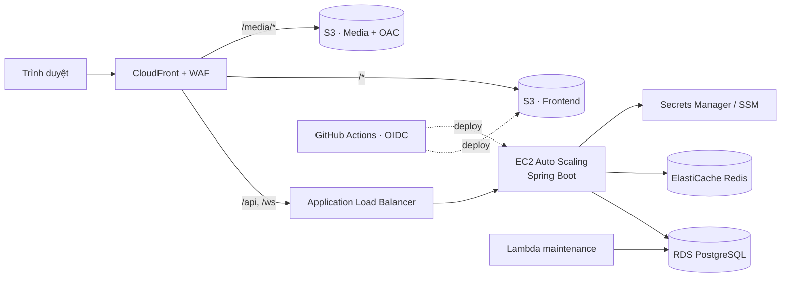

<div align="center">

# 🎟️ TicketRush

**Nền tảng đặt vé sự kiện realtime — từ chọn ghế, giữ chỗ, hàng đợi đến soát vé QR.**

[](https://github.com/notvux00/TicketRushh/actions/workflows/ci.yml)
[](https://ticketrush.sudothanh.me)
[](https://openjdk.org/)
[](https://spring.io/projects/spring-boot)
[](https://react.dev/)
[](https://www.postgresql.org/)
[](https://redis.io/)
[](https://www.terraform.io/)

[🌐 Demo trực tuyến](https://ticketrush.sudothanh.me) ·
[📖 Tài liệu](docs/README.md) ·
[🏗️ Kiến trúc](docs/ARCHITECTURE.md) ·
[🚀 Triển khai](docs/AWS_DEPLOY.md)

</div>

---

TicketRush là ứng dụng đặt vé sự kiện end-to-end: người dùng tìm sự kiện, chọn ghế/khu, giữ chỗ theo thời gian thực, áp voucher và nhận vé QR có chữ ký; quản trị viên theo dõi doanh thu, quản lý sự kiện/voucher và soát vé tại cổng. Hệ thống được thiết kế cho các đợt mở bán cao điểm với **virtual queue**, **Redis seat lock** và **admission lease** chống oversell.

Demo đang chạy trên AWS tại **<https://ticketrush.sudothanh.me>**, hạ tầng quản lý hoàn toàn bằng Terraform.

## ✨ Tính năng

| Nhóm | Nổi bật |
| --- | --- |
| **Người dùng** | Đăng ký/đăng nhập JWT, hồ sơ cá nhân, khám phá sự kiện, chọn ghế theo sơ đồ, giỏ vé, voucher và “Vé của tôi”. |
| **Đặt vé** | Giữ ghế nguyên tử bằng Redis Lua, checkout giới hạn thời gian, snapshot giá vé, chống oversell và tự nhả chỗ khi hết hạn. |
| **Hàng đợi** | Virtual queue theo suất diễn, cấp pass/lease, threshold + hard capacity, đối soát sau restart hoặc mất Redis notification. |
| **Vé & soát vé** | QR ký HMAC (`TKRUSH:v1:...`), chỉ đơn hoàn tất mới hợp lệ, chống quét trùng; admin quét bằng camera hoặc nhập payload. |
| **Quản trị** | Dashboard doanh thu/vé/người dùng, CRUD sự kiện–zone–ghế, quản lý voucher có audit, thống kê check-in realtime. |
| **Vận hành** | Flyway migration, ShedLock scheduler, maintenance worker trên Lambda, health checks và Terraform CI/CD. |

## 🏗️ Kiến trúc



- **Frontend** React SPA gọi API cùng origin; CloudFront route `/api/*` và `/ws*` về ALB, static asset về S3, media private qua OAC.
- **Backend** Spring Boot chạy trên EC2 private, dùng PostgreSQL cho dữ liệu giao dịch và Redis cho seat lock, queue lease, pub/sub realtime.
- **Realtime** dùng STOMP WebSocket, relay sự kiện qua Redis Pub/Sub để mọi instance đều nhận được cập nhật.
- **Hạ tầng** chia module Terraform: network, security, compute, data, edge, observability và maintenance worker.

Chi tiết luồng booking, schema và API: [docs/ARCHITECTURE.md](docs/ARCHITECTURE.md).

## 🧰 Công nghệ

| Thành phần | Công nghệ |
| --- | --- |
| Frontend | React 19, Vite 8, Tailwind CSS 4, TanStack Query, React Router, STOMP, jsQR |
| Backend | Java 17, Spring Boot 3.5, Spring Security/JWT, Spring Data JPA, Flyway |
| Dữ liệu | PostgreSQL 16, Redis 7 (Lua, keyspace notifications, Pub/Sub) |
| Media | Amazon S3 + CloudFront OAC; local dùng Adobe S3Mock |
| Hạ tầng | Terraform, EC2 Auto Scaling, ALB, RDS, ElastiCache, Lambda, CloudFront, WAF |
| CI/CD | GitHub Actions, OIDC (không lưu AWS access key dài hạn) |
| Kiểm thử | JUnit/Mockito, Playwright, Node test runner, Python unittest, k6 |

## 🚀 Chạy local

**Yêu cầu:** Docker Compose và Node.js >= 22.12. Chạy backend ngoài Docker cần JDK 17.

```bash
cp .env.example .env
cp frontend/.env-example.txt frontend/.env

docker compose up -d postgres redis s3mock
docker compose --profile app run --rm --no-deps frontend npm ci
docker compose --profile app up --build
```

| Dịch vụ | Địa chỉ |
| --- | --- |
| Frontend | <http://localhost:5173> |
| Backend readiness | <http://localhost:8080/actuator/health/readiness> |
| PostgreSQL | `localhost:5432` — DB `ticketrush` |
| Redis | `localhost:6379` |
| Adobe S3Mock | <http://localhost:9090> |

Tài khoản admin local lấy từ `.env` (mặc định `admin@gmail.com / admin123`). **Đổi thông tin này trước khi public.**

> Chạy app ngoài Docker, cấu hình biến môi trường và xử lý sự cố: xem [docs/LOCAL_DEV.md](docs/LOCAL_DEV.md).

## 🧪 Kiểm thử

```bash
(cd backend && ./mvnw -B verify)
(cd frontend && npm ci && npm run lint && npm run build)
(cd frontend && npx playwright install chromium && npm run test:browser)

node --test tests/*.test.cjs
python -m unittest discover -s tests -p 'test_*.py' -v
```

CI chạy backend, frontend, contract test, Terraform validate và worker test trên mỗi push/PR — xem [`.github/workflows/ci.yml`](.github/workflows/ci.yml).

## 📦 Cấu trúc dự án

```text
TicketRushh/
├── backend/                  # Spring Boot API · Flyway · JUnit
│   └── src/main/java/com/ticketrush/
│       ├── controller/       # REST API
│       ├── service/          # Booking, queue, voucher, check-in
│       ├── repository/       # Spring Data JPA
│       ├── realtime/         # WebSocket + Redis Pub/Sub
│       └── config/           # Security, Redis, S3, scheduler
├── frontend/                 # React SPA · Playwright
│   └── src/{pages,components,api,context}/
├── infra/
│   ├── terraform/            # Modules + demo/prod environments
│   └── lambda/maintenance/   # Worker dọn dữ liệu hết hạn
├── docs/                     # Kiến trúc, deploy, runbook, demo
├── diagrams/                 # Script dựng sơ đồ
├── scripts/                  # Deploy/smoke helpers
├── tests/                    # Cross-cutting Node & Python tests
├── docker-compose.yml
├── seed-demo.sql
└── .env.example
```

## ☁️ Triển khai

Hạ tầng AWS được định nghĩa bằng Terraform và triển khai qua các workflow thủ công có gate xác nhận:

- [`deploy-backend.yml`](.github/workflows/deploy-backend.yml) — build image, cập nhật EC2/ASG.
- [`deploy-frontend.yml`](.github/workflows/deploy-frontend.yml) — build Vite và đồng bộ lên S3/CloudFront.
- [`terraform.yml`](.github/workflows/terraform.yml) — plan/apply theo môi trường.

Quy trình bootstrap state backend, DNS, OIDC và phát hành demo: [docs/AWS_DEPLOY.md](docs/AWS_DEPLOY.md). Vận hành, rollback và destroy: [docs/RUNBOOK.md](docs/RUNBOOK.md).

## 📚 Tài liệu

| Tài liệu | Nội dung |
| --- | --- |
| [Mục lục](docs/README.md) | Toàn bộ tài liệu dự án |
| [Kiến trúc](docs/ARCHITECTURE.md) | Thành phần, luồng booking/queue, admin API, schema |
| [Local dev](docs/LOCAL_DEV.md) | Docker Compose, biến môi trường, kiểm thử |
| [Triển khai AWS](docs/AWS_DEPLOY.md) | Bootstrap, DNS, worker package, deploy demo |
| [Hạ tầng AWS](docs/AWS_INFRASTRUCTURE.md) | Đặc tả kiến trúc và cấu hình hạ tầng |
| [Runbook](docs/RUNBOOK.md) | Health, log, sự cố, rollback, destroy |
| [Kịch bản demo](docs/DEMO_SCRIPT.md) | Luồng demo theo chức năng |
| [Chi phí](docs/COST.md) | Các nguồn chi phí và cách dự toán |
| [Terraform](infra/terraform/README.md) | Module, environment, state |
| [Maintenance worker](infra/lambda/maintenance/README.md) | SQL jobs, đóng gói, vận hành Lambda |

## ⚠️ Lưu ý

- Thanh toán hiện là **giả lập**, chưa tích hợp cổng thanh toán hoặc xác nhận chuyển khoản thật.
- Camera soát vé cần **HTTPS hoặc localhost**; chức năng nhập QR dùng được khi không có camera.
- Không sửa migration Flyway đã áp dụng — thay đổi schema phải thêm migration mới.
- Không commit `.env`, Terraform state/tfvars hay secret thật; dùng file `*.example` làm mẫu.

---

<div align="center">
<sub>Quy trình phát triển nội bộ: <a href="AGENT.md">AGENT.md</a> · Backlog: <a href="task.md">task.md</a></sub>
</div>
