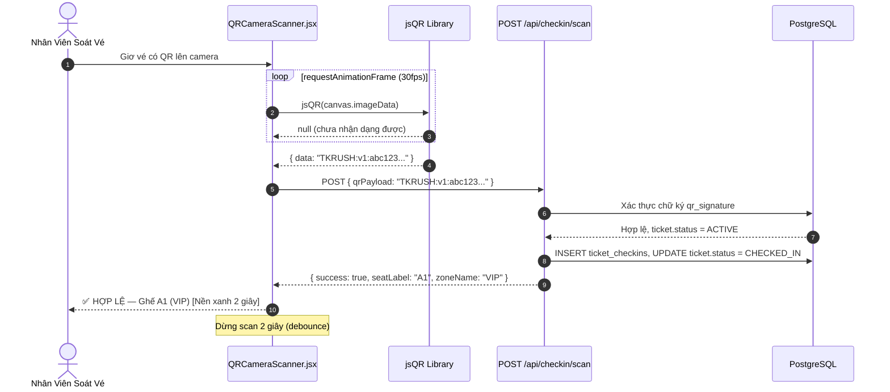
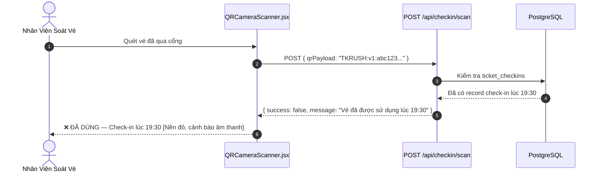

# TÀI LIỆU ĐẶC TẢ KỸ THUẬT: WEB QR SCANNER CHECK-IN CHO ADMIN

* **Tên dự án:** TicketRush System
* **Phân hệ:** Admin Operations — Event Gate Check-In
* **Trạng thái:** Architecture & Technical Specification
* **Phiên bản:** 1.0.0

---

## MỤC LỤC
1. [Tổng quan & Phân tích hiện trạng](#1-tổng-quan--phân-tích-hiện-trạng)
2. [Thiết kế API & Cập nhật Backend](#2-thiết-kế-api--cập-nhật-backend)
3. [Thư viện & Cơ chế hoạt động Camera Web](#3-thư-viện--cơ-chế-hoạt-động-camera-web)
4. [Danh sách file cần tạo mới & chỉnh sửa](#4-danh-sách-file-cần-tạo-mới--chỉnh-sửa)
5. [Sơ đồ tuần tự](#5-sơ-đồ-tuần-tự)
6. [Tích hợp mã nguồn chi tiết (Implementation Blueprint)](#6-tích-hợp-mã-nguồn-chi-tiết-implementation-blueprint)
7. [Kế hoạch Kiểm thử](#7-kế-hoạch-kiểm-thử)
8. [Tiêu chuẩn hoàn thành (Definition of Done - DoD)](#8-tiêu-chuẩn-hoàn-thành-definition-of-done---dod)

---

## 1. TỔNG QUAN & PHÂN TÍCH HIỆN TRẠNG

### 1.1. Những gì đã có sẵn

| Thành phần | Trạng thái | Mô tả |
| :--- | :---: | :--- |
| `CheckinController.java` | ✅ Hoàn chỉnh | `POST /api/checkin/scan` nhận `qrPayload`, trả về kết quả check-in |
| `CheckinService.java` | ✅ Hoàn chỉnh | Xác thực chữ ký `qr_signature`, ghi `ticket_checkins` audit log |
| `TicketCheckin.java` | ✅ Hoàn chỉnh | Entity ghi lại ai check-in, lúc nào, tại cổng nào |
| `Trang Admin Check-in` | ❌ Chưa có | Không có giao diện nào để nhân viên sử dụng |
| `QR Scanner Camera` | ❌ Chưa có | Không có component đọc QR từ camera |

### 1.2. Vấn đề thực tế

Nhân viên soát vé hiện tại **không thể** thực hiện check-in từ trình duyệt. API `POST /api/checkin/scan` hoàn toàn không có giao diện người dùng. Nhân viên buộc phải dùng công cụ bên ngoài hoặc thực hiện thủ công.

### 1.3. Mục tiêu tính năng

Xây dựng trang `/admin/checkin` với:
- **Camera QR Scanner:** Mở webcam/camera điện thoại, quét mã QR liên tục.
- **Phản hồi tức thì:** Hiển thị kết quả (HỢP LỆ / ĐÃ DÙNG / GIẢ MẠO) trong < 1 giây.
- **Thống kê live:** Số lượng đã vào cổng / tổng vé của suất diễn được chọn.
- **Lịch sử scan gần đây:** 10 lần scan cuối (tên ghế, zone, thời gian, kết quả).

### 1.4. Bổ sung API thống kê check-in theo suất diễn

Hiện tại chưa có endpoint trả về số lượng đã check-in. Cần bổ sung:

```
GET /api/admin/checkin/stats/{showtimeId}
Response: { checkedIn: 42, totalTickets: 120, pendingEntry: 78 }
```

---

## 2. THIẾT KẾ API & CẬP NHẬT BACKEND

### 2.1. API có sẵn — Dùng nguyên

```
POST /api/checkin/scan
Body: { "qrPayload": "TKRUSH:v1:..." }
Response (success): { success: true, seatLabel: "A1", zoneName: "VIP", checkedInAt: "..." }
Response (failure): { success: false, message: "Vé đã được sử dụng" }
```

### 2.2. API mới cần thêm

```
GET /api/admin/checkin/stats/{showtimeId}
Authorization: Bearer <ADMIN_TOKEN>
Response:
{
  "showtimeId": "...",
  "totalTickets": 120,
  "checkedIn": 42,
  "pendingEntry": 78,
  "checkInRate": 35.0
}
```

#### Truy vấn SQL cho stats:

```sql
SELECT
    COUNT(t.id) AS total_tickets,
    COUNT(t.id) FILTER (WHERE t.status = 'CHECKED_IN') AS checked_in
FROM tickets t
JOIN orders o ON o.id = t.order_id
JOIN seats s ON s.id = t.seat_id
JOIN zones z ON z.id = s.zone_id
WHERE o.status = 'COMPLETED'
  AND z.showtime_id = :showtimeId;
```

### 2.3. Cập nhật `SecurityConfig.java`

```java
// Thêm vào danh sách ADMIN-only endpoints:
.requestMatchers("/api/admin/checkin/**").hasRole("ADMIN")
```

---

## 3. THƯ VIỆN & CƠ CHẾ HOẠT ĐỘNG CAMERA WEB

### 3.1. Thư viện đề xuất: `jsQR`

```bash
npm install jsqr
```

**Lý do chọn `jsQR` thay vì `@zxing/browser`:**
- Nhẹ hơn (~25KB vs ~200KB gzipped).
- Thuần JavaScript, không phụ thuộc WebAssembly.
- Dễ tích hợp vào React với `useRef` + `requestAnimationFrame`.
- Hỗ trợ tốt QR code kiểu `TKRUSH:v1:...` (plain text).

### 3.2. Cơ chế hoạt động

```
Camera (getUserMedia API)
    │
    ▼
<video> element (live stream)
    │
    ▼  (mỗi frame ~30fps)
<canvas> (drawImage từ video)
    │
    ▼
jsQR(imageData, width, height)
    │
    ├─ Nếu tìm thấy QR code:
    │       └─► POST /api/checkin/scan { qrPayload: code.data }
    │                   │
    │                   ├─ success: true  → Hiển thị ✅ HỢP LỆ (xanh)
    │                   └─ success: false → Hiển thị ❌ Lỗi (đỏ)
    │
    └─ Nếu không tìm thấy: tiếp tục quét frame tiếp theo
```

### 3.3. Chống scan trùng (Debounce)

Sau mỗi lần scan thành công hoặc thất bại, **tạm dừng vòng lặp quét 2 giây** để tránh gọi API nhiều lần cho cùng 1 mã QR.

```javascript
const DEBOUNCE_MS = 2000;
let lastScannedCode = null;
let lastScannedAt = 0;

// Trong vòng lặp quét:
if (code.data === lastScannedCode && Date.now() - lastScannedAt < DEBOUNCE_MS) {
  return; // Bỏ qua, đây là cùng 1 vé
}
lastScannedCode = code.data;
lastScannedAt = Date.now();
```

---

## 4. DANH SÁCH FILE CẦN TẠO MỚI & CHỈNH SỬA

```
backend/
└── src/main/java/com/ticketrush/
    └── controller/
        └── CheckinController.java             [CHỈNH SỬA: Thêm GET /api/admin/checkin/stats/{id}]

frontend/
├── src/pages/
│   └── AdminCheckin.jsx                       [TẠO MỚI: Trang scanner chính]
├── src/components/
│   └── checkin/
│       ├── QRCameraScanner.jsx                [TẠO MỚI: Component camera + jsQR]
│       ├── CheckinResultCard.jsx              [TẠO MỚI: Hiển thị kết quả scan]
│       └── CheckinStatsPanel.jsx             [TẠO MỚI: Thống kê live theo suất diễn]
├── src/api/
│   └── eventApi.js                           [CHỈNH SỬA: Thêm scanTicket(), getCheckinStats()]
└── src/App.jsx                               [CHỈNH SỬA: Thêm route /admin/checkin]

Thêm vào AdminSidebar.jsx:
└── Link "Soát vé" → /admin/checkin
```

---

## 5. SƠ ĐỒ TUẦN TỰ

### 5.1. Luồng quét QR thành công



### 5.2. Luồng quét QR đã dùng hoặc giả mạo



---

## 6. TÍCH HỢP MÃ NGUỒN CHI TIẾT (IMPLEMENTATION BLUEPRINT)

### 6.1. `QRCameraScanner.jsx`

```jsx
import { useEffect, useRef, useState } from "react";
import jsQR from "jsqr";

export default function QRCameraScanner({ onScan }) {
  const videoRef = useRef(null);
  const canvasRef = useRef(null);
  const animFrameRef = useRef(null);
  const lastScanned = useRef({ code: null, at: 0 });
  const [cameraError, setCameraError] = useState(null);

  useEffect(() => {
    let stream;

    const startCamera = async () => {
      try {
        stream = await navigator.mediaDevices.getUserMedia({
          video: { facingMode: "environment" }, // Dùng camera sau trên điện thoại
        });
        videoRef.current.srcObject = stream;
        await videoRef.current.play();
        scanLoop();
      } catch (err) {
        setCameraError("Không thể truy cập camera. Vui lòng cấp quyền.");
      }
    };

    const scanLoop = () => {
      const video = videoRef.current;
      const canvas = canvasRef.current;
      if (!video || !canvas || video.readyState !== 4) {
        animFrameRef.current = requestAnimationFrame(scanLoop);
        return;
      }

      const ctx = canvas.getContext("2d");
      canvas.width = video.videoWidth;
      canvas.height = video.videoHeight;
      ctx.drawImage(video, 0, 0, canvas.width, canvas.height);
      const imageData = ctx.getImageData(0, 0, canvas.width, canvas.height);
      const code = jsQR(imageData.data, imageData.width, imageData.height);

      if (code) {
        const now = Date.now();
        const { code: lastCode, at: lastAt } = lastScanned.current;
        if (code.data !== lastCode || now - lastAt > 2000) {
          lastScanned.current = { code: code.data, at: now };
          onScan(code.data); // Gọi callback lên component cha
        }
      }

      animFrameRef.current = requestAnimationFrame(scanLoop);
    };

    startCamera();

    return () => {
      cancelAnimationFrame(animFrameRef.current);
      stream?.getTracks().forEach((t) => t.stop());
    };
  }, [onScan]);

  if (cameraError) {
    return (
      <div className="flex items-center justify-center h-64 bg-red-50 rounded-2xl text-red-600 font-bold">
        {cameraError}
      </div>
    );
  }

  return (
    <div className="relative rounded-2xl overflow-hidden bg-black">
      <video ref={videoRef} className="w-full" playsInline muted />
      <canvas ref={canvasRef} className="hidden" />
      {/* Viewfinder overlay */}
      <div className="absolute inset-0 flex items-center justify-center pointer-events-none">
        <div className="w-56 h-56 border-4 border-white/70 rounded-2xl shadow-[0_0_0_9999px_rgba(0,0,0,0.5)]" />
      </div>
    </div>
  );
}
```

### 6.2. `AdminCheckin.jsx` (skeleton)

```jsx
import { useState, useCallback } from "react";
import axiosClient from "../api/axiosClient";
import QRCameraScanner from "../components/checkin/QRCameraScanner";
import CheckinResultCard from "../components/checkin/CheckinResultCard";

export default function AdminCheckin() {
  const [result, setResult] = useState(null);
  const [scanning, setScanning] = useState(false);

  const handleScan = useCallback(async (qrPayload) => {
    try {
      const res = await axiosClient.post("/checkin/scan", { qrPayload });
      setResult({ ...res.data, timestamp: new Date() });
    } catch (err) {
      setResult({ success: false, message: "Lỗi kết nối máy chủ." });
    }
  }, []);

  return (
    <div className="p-8 max-w-2xl mx-auto">
      <h1 className="text-3xl font-black mb-8">📱 Soát Vé QR</h1>

      {/* Camera Scanner */}
      <QRCameraScanner onScan={handleScan} />

      {/* Result Display */}
      {result && <CheckinResultCard result={result} />}

      {/* Stats Panel — Chọn suất diễn để xem thống kê live */}
      {/* <CheckinStatsPanel /> */}
    </div>
  );
}
```

### 6.3. `CheckinResultCard.jsx` (design spec)

```
Kết quả SUCCESS:
┌──────────────────────────────────────────┐
│ ✅ VÉ HỢP LỆ                            │  ← Nền xanh emerald
│                                          │
│  Ghế: A1          Zone: VIP             │
│  Check-in lúc: 19:45:23                 │
└──────────────────────────────────────────┘

Kết quả ALREADY USED:
┌──────────────────────────────────────────┐
│ ❌ VÉ ĐÃ ĐƯỢC SỬ DỤNG                  │  ← Nền đỏ
│                                          │
│  Đã check-in lúc: 19:30:12             │
│  Vui lòng liên hệ ban tổ chức.          │
└──────────────────────────────────────────┘

Kết quả INVALID SIGNATURE:
┌──────────────────────────────────────────┐
│ ⚠️ VÉ KHÔNG HỢP LỆ / GIẢ MẠO         │  ← Nền cam
│                                          │
│  Chữ ký QR không khớp.                  │
│  Từ chối vào cổng.                       │
└──────────────────────────────────────────┘
```

---

## 7. KẾ HOẠCH KIỂM THỬ

| Test ID | Kịch Bản | Điều Kiện | Kết Quả Mong Đợi |
| :--- | :--- | :--- | :--- |
| **TC-CI01** | **Quét vé hợp lệ lần đầu** | Ticket status = ACTIVE, chữ ký đúng | Hiển thị ✅, ticket status cập nhật CHECKED_IN |
| **TC-CI02** | **Quét vé đã dùng** | Ticket đã có record trong ticket_checkins | Hiển thị ❌, thông báo giờ check-in cũ |
| **TC-CI03** | **Quét vé giả mạo** | qrPayload bị sửa, chữ ký không khớp | Hiển thị ⚠️ GIẢ MẠO, từ chối |
| **TC-CI04** | **Quét 2 lần liên tiếp cùng vé (debounce)** | Scan cùng 1 QR trong vòng 2 giây | Chỉ gọi API 1 lần duy nhất |
| **TC-CI05** | **Camera trên điện thoại** | Mở trang trên mobile browser | Camera sau (environment) được sử dụng mặc định |
| **TC-CI06** | **Từ chối camera** | User từ chối quyền camera | Hiển thị thông báo lỗi rõ ràng, không crash |
| **TC-CI07** | **Thống kê live** | 5 người check-in, xem stats panel | checkedIn tăng lên 5, pendingEntry giảm 5 |
| **TC-CI08** | **Phân quyền** | User thường truy cập /admin/checkin | Redirect về trang chủ hoặc 403 |

---

## 8. TIÊU CHUẨN HOÀN THÀNH (DEFINITION OF DONE - DOD)

- [ ] Camera mở được trên cả desktop (Chrome) và mobile browser (Chrome/Safari iOS).
- [ ] Nhận dạng QR code `TKRUSH:v1:...` thành công trong điều kiện ánh sáng bình thường.
- [ ] Phản hồi kết quả scan trong < 1 giây sau khi nhận dạng QR.
- [ ] Cơ chế debounce 2 giây hoạt động, không gọi API trùng lặp.
- [ ] Hiển thị đúng 3 trạng thái: HỢP LỆ (xanh) / ĐÃ DÙNG (đỏ) / GIẢ MẠO (cam).
- [ ] `GET /api/admin/checkin/stats/{showtimeId}` trả về số liệu chính xác.
- [ ] Thêm link "Soát vé" vào `AdminSidebar.jsx`.
- [ ] Route `/admin/checkin` được bảo vệ, chỉ ADMIN được truy cập.

