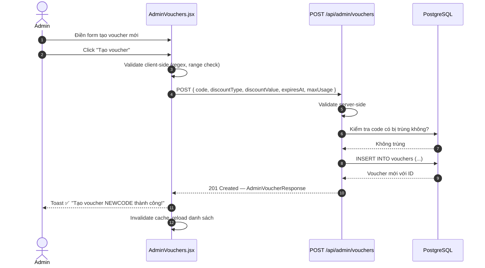

# TÀI LIỆU ĐẶC TẢ KỸ THUẬT: ADMIN QUẢN LÝ VOUCHER TỪ GIAO DIỆN

* **Tên dự án:** TicketRush System
* **Phân hệ:** Admin Control Panel — Voucher CRUD Engine
* **Trạng thái:** Architecture & Technical Specification
* **Phiên bản:** 1.0.0

---

## MỤC LỤC
1. [Tổng quan & Phân tích hiện trạng](#1-tổng-quan--phân-tích-hiện-trạng)
2. [Thiết kế API Backend (Voucher CRUD)](#2-thiết-kế-api-backend-voucher-crud)
3. [Database Migration V5](#3-database-migration-v5)
4. [Danh sách file cần tạo mới & chỉnh sửa](#4-danh-sách-file-cần-tạo-mới--chỉnh-sửa)
5. [Sơ đồ luồng & Thiết kế UI](#5-sơ-đồ-luồng--thiết-kế-ui)
6. [Tích hợp mã nguồn chi tiết (Implementation Blueprint)](#6-tích-hợp-mã-nguồn-chi-tiết-implementation-blueprint)
7. [Kế hoạch Kiểm thử](#7-kế-hoạch-kiểm-thử)
8. [Tiêu chuẩn hoàn thành (Definition of Done - DoD)](#8-tiêu-chuẩn-hoàn-thành-definition-of-done---dod)

---

## 1. TỔNG QUAN & PHÂN TÍCH HIỆN TRẠNG

### 1.1. Giới hạn của thiết kế hiện tại

Toàn bộ voucher trong hệ thống được tạo cứng (seed) bởi `VoucherDataInitializer.java` lúc khởi động:

```java
// VoucherDataInitializer.java
createIfNotExists("RUSH100", "FIXED", 100_000.0, null);  // Giảm 100k
createIfNotExists("SALE10",  "PERCENT", 10.0, null);      // Giảm 10%
createIfNotExists("VIP50",   "FIXED", 50_000.0, null);    // Giảm 50k
```

**Hậu quả:**
- Admin **không thể tạo voucher mới** mà không sửa code và restart server.
- Admin **không thể bật/tắt** voucher khi flash sale kết thúc.
- Admin **không thể xóa** voucher hết hạn.
- **Không tracking** được ai đã dùng voucher, bao nhiêu lần, tiết kiệm bao nhiêu.

### 1.2. Mục tiêu tính năng

Xây dựng trang `/admin/vouchers` với đầy đủ CRUD và analytics:

| Chức năng | Mô tả |
| :--- | :--- |
| **Danh sách voucher** | Hiển thị tất cả voucher với code, loại, giá trị, hạn dùng, trạng thái, số lần dùng |
| **Tạo voucher mới** | Form tạo với validation đầy đủ |
| **Toggle bật/tắt** | Bật/tắt voucher ngay lập tức không cần restart |
| **Xóa voucher** | Xóa voucher chưa được dùng hoặc đã hết hạn |
| **Thống kê usage** | Số lần dùng, tổng tiền tiết kiệm cho khách, revenue impact |

---

## 2. THIẾT KẾ API BACKEND (VOUCHER CRUD)

### 2.1. Danh sách endpoints mới

```
GET    /api/admin/vouchers                  → Lấy tất cả voucher + usage stats
POST   /api/admin/vouchers                  → Tạo voucher mới
PATCH  /api/admin/vouchers/{id}/toggle      → Bật/tắt active
DELETE /api/admin/vouchers/{id}             → Xóa voucher
```

> **Bảo mật:** Tất cả endpoint đều yêu cầu `hasRole("ADMIN")`.

### 2.2. DTOs

#### Request: `CreateVoucherRequest.java`

```java
@Data
public class CreateVoucherRequest {
    @NotBlank
    @Pattern(regexp = "^[A-Z0-9]{4,20}$", message = "Mã voucher chỉ gồm chữ hoa và số, 4-20 ký tự")
    private String code;

    @NotNull
    private String discountType;    // "FIXED" | "PERCENT"

    @NotNull
    @Positive
    private Double discountValue;   // VD: 100000 (FIXED) hoặc 10 (PERCENT = 10%)

    @Future
    private LocalDateTime expiresAt; // Null = không hết hạn

    @Min(1)
    private Integer maxUsage;        // Null = không giới hạn số lần dùng
}
```

#### Response: `AdminVoucherResponse.java`

```java
@Data
public class AdminVoucherResponse {
    private UUID id;
    private String code;
    private String discountType;
    private Double discountValue;
    private Boolean active;
    private LocalDateTime expiresAt;
    private Integer maxUsage;

    // Thống kê usage (join với orders)
    private Long usageCount;      // Số đơn COMPLETED đã dùng voucher này
    private Double totalSaved;    // SUM(discount_amount) từ các đơn COMPLETED
}
```

### 2.3. Validation rules

| Trường | Rule |
| :--- | :--- |
| `code` | Chỉ chữ hoa A-Z và số 0-9, 4–20 ký tự, **unique** |
| `discountType` | Chỉ nhận "FIXED" hoặc "PERCENT" |
| `discountValue` | FIXED: > 0, PERCENT: 1–100 |
| `expiresAt` | Phải là ngày trong tương lai (nếu có) |
| `maxUsage` | >= 1 (nếu có) |

---

## 3. DATABASE MIGRATION V5

### 3.1. File: `V5__voucher_enhancements.sql`

```sql
-- Bổ sung các trường quản lý nâng cao cho bảng vouchers
ALTER TABLE vouchers ADD COLUMN IF NOT EXISTS expires_at   TIMESTAMP;
ALTER TABLE vouchers ADD COLUMN IF NOT EXISTS max_usage    INTEGER;
ALTER TABLE vouchers ADD COLUMN IF NOT EXISTS created_at   TIMESTAMP NOT NULL DEFAULT NOW();
ALTER TABLE vouchers ADD COLUMN IF NOT EXISTS created_by   VARCHAR(255);  -- Email của admin tạo

-- Index cho code lookup (đã có UNIQUE nhưng thêm index explicit)
CREATE INDEX IF NOT EXISTS idx_vouchers_code ON vouchers(code);
CREATE INDEX IF NOT EXISTS idx_vouchers_active ON vouchers(active);
```

> **Lưu ý quan trọng:** Không được sửa các file `V1` đến `V4`. Chỉ tạo file `V5` mới.

### 3.2. Cập nhật `Voucher.java` entity

```java
// Thêm các trường mới vào entity hiện có:
@Column(name = "expires_at")
private LocalDateTime expiresAt;

@Column(name = "max_usage")
private Integer maxUsage;

@Column(name = "created_at")
private LocalDateTime createdAt;

@Column(name = "created_by")
private String createdBy; // Email admin

@PrePersist
public void prePersist() {
    if (this.createdAt == null) this.createdAt = LocalDateTime.now();
}
```

---

## 4. DANH SÁCH FILE CẦN TẠO MỚI & CHỈNH SỬA

```
backend/
├── src/main/resources/db/migration/
│   └── V5__voucher_enhancements.sql           [TẠO MỚI: Thêm expires_at, max_usage, created_at]
└── src/main/java/com/ticketrush/
    ├── controller/
    │   └── AdminVoucherController.java         [TẠO MỚI: 4 endpoints CRUD]
    ├── service/
    │   └── AdminVoucherService.java            [TẠO MỚI: Business logic + usage stats]
    ├── model/
    │   ├── entity/
    │   │   └── Voucher.java                    [CHỈNH SỬA: Thêm expires_at, max_usage, createdAt]
    │   └── dto/
    │       ├── CreateVoucherRequest.java        [TẠO MỚI]
    │       └── AdminVoucherResponse.java        [TẠO MỚI]
    ├── config/
    │   └── SecurityConfig.java                 [CHỈNH SỬA: Thêm /api/admin/vouchers/** → ADMIN]
    └── config/
        └── VoucherDataInitializer.java         [GIỮ NGUYÊN: Seed voucher ban đầu vẫn hữu ích]

frontend/
├── src/pages/
│   └── AdminVouchers.jsx                      [TẠO MỚI: Trang CRUD voucher]
├── src/api/
│   └── eventApi.js                            [CHỈNH SỬA: Thêm voucherApi functions]
└── src/App.jsx                                [CHỈNH SỬA: Thêm route /admin/vouchers]

Thêm vào AdminSidebar.jsx:
└── Link "Voucher" → /admin/vouchers
```

---

## 5. SƠ ĐỒ LUỒNG & THIẾT KẾ UI

### 5.1. Luồng tạo voucher mới



### 5.2. Bố cục UI `AdminVouchers.jsx`

```
┌─────────────────────────────────────────────────────────────┐
│  🏷️ Quản Lý Voucher                     [+ Tạo Voucher]    │
├─────────────────────────────────────────────────────────────┤
│  CODE        │ LOẠI    │ GIÁ TRỊ │ HẾT HẠN  │ DÙNG │ TRẠNG THÁI │ THAO TÁC │
│  RUSH100     │ Cố định │ -100k   │ Vĩnh viễn│  47  │ 🟢 Active  │ 🔴 Tắt   │ 🗑️  │
│  SALE10      │ %       │ -10%    │ Vĩnh viễn│  23  │ 🟢 Active  │ 🔴 Tắt   │ 🗑️  │
│  VIP50       │ Cố định │ -50k    │ Vĩnh viễn│   8  │ 🔴 Inactive│ 🟢 Bật   │ 🗑️  │
├─────────────────────────────────────────────────────────────┤
│  TỔNG: 3 voucher │ 2 đang hoạt động │ Đã tiết kiệm: 6.6M đ │
└─────────────────────────────────────────────────────────────┘

[Modal Tạo Voucher]
┌─────────────────────────────────────────┐
│  Tạo Voucher Mới                    [X] │
├─────────────────────────────────────────┤
│  Mã voucher *    [SUMMER2026           ]│
│  Loại giảm       ○ Cố định  ● Phần trăm│
│  Giá trị *       [15                  ]│  ← 15%
│  Ngày hết hạn    [2026-12-31          ]│  ← Trống = vĩnh viễn
│  Giới hạn dùng   [100                 ]│  ← Trống = không giới hạn
│                                         │
│            [Hủy]  [Tạo Voucher]        │
└─────────────────────────────────────────┘
```

---

## 6. TÍCH HỢP MÃ NGUỒN CHI TIẾT (IMPLEMENTATION BLUEPRINT)

### 6.1. `AdminVoucherController.java`

```java
@RestController
@RequestMapping("/api/admin/vouchers")
@RequiredArgsConstructor
@PreAuthorize("hasRole('ADMIN')")
public class AdminVoucherController {

    private final AdminVoucherService voucherService;

    @GetMapping
    public List<AdminVoucherResponse> getAllVouchers() {
        return voucherService.getAllWithStats();
    }

    @PostMapping
    public ResponseEntity<AdminVoucherResponse> createVoucher(
            @Valid @RequestBody CreateVoucherRequest request,
            Authentication authentication) {
        AdminVoucherResponse created = voucherService.create(request, authentication.getName());
        return ResponseEntity.status(HttpStatus.CREATED).body(created);
    }

    @PatchMapping("/{id}/toggle")
    public AdminVoucherResponse toggleVoucher(@PathVariable UUID id) {
        return voucherService.toggleActive(id);
    }

    @DeleteMapping("/{id}")
    public ResponseEntity<Void> deleteVoucher(@PathVariable UUID id) {
        voucherService.delete(id);
        return ResponseEntity.noContent().build();
    }
}
```

### 6.2. `AdminVoucherService.java` (skeleton)

```java
@Service
@RequiredArgsConstructor
public class AdminVoucherService {

    private final VoucherRepository voucherRepository;
    private final OrderRepository orderRepository;

    public List<AdminVoucherResponse> getAllWithStats() {
        // Lấy tất cả voucher, với mỗi voucher JOIN vào orders để tính usage stats
        return voucherRepository.findAllWithUsageStats();
    }

    public AdminVoucherResponse create(CreateVoucherRequest request, String adminEmail) {
        // Kiểm tra code trùng
        if (voucherRepository.existsByCode(request.getCode())) {
            throw new ResponseStatusException(HttpStatus.CONFLICT, "Mã voucher đã tồn tại.");
        }
        Voucher voucher = Voucher.builder()
            .code(request.getCode())
            .discountType(request.getDiscountType())
            .discountValue(request.getDiscountValue())
            .active(true)
            .expiresAt(request.getExpiresAt())
            .maxUsage(request.getMaxUsage())
            .createdBy(adminEmail)
            .build();
        return toResponse(voucherRepository.save(voucher), 0L, 0.0);
    }

    public AdminVoucherResponse toggleActive(UUID id) {
        Voucher voucher = voucherRepository.findById(id)
            .orElseThrow(() -> new ResponseStatusException(HttpStatus.NOT_FOUND));
        voucher.setActive(!voucher.getActive());
        voucherRepository.save(voucher);
        // Trả về response với usage stats
        return toResponseWithStats(voucher);
    }

    public void delete(UUID id) {
        Voucher voucher = voucherRepository.findById(id)
            .orElseThrow(() -> new ResponseStatusException(HttpStatus.NOT_FOUND));
        voucherRepository.delete(voucher);
    }
}
```

### 6.3. Query `findAllWithUsageStats` trong `VoucherRepository.java`

```java
@Query(value = """
    SELECT
        v.*,
        COUNT(o.id) FILTER (WHERE o.status = 'COMPLETED') AS usage_count,
        COALESCE(SUM(o.discount_amount) FILTER (WHERE o.status = 'COMPLETED'), 0) AS total_saved
    FROM vouchers v
    LEFT JOIN orders o ON o.voucher_id = v.id
    GROUP BY v.id
    ORDER BY v.created_at DESC
    """, nativeQuery = true)
List<Object[]> findAllWithUsageStats();
```

### 6.4. `AdminVouchers.jsx` (skeleton)

```jsx
import { useQuery, useMutation, useQueryClient } from "@tanstack/react-query";
import { useState } from "react";
import axiosClient from "../api/axiosClient";

export default function AdminVouchers() {
  const queryClient = useQueryClient();
  const [showCreateModal, setShowCreateModal] = useState(false);

  const { data: vouchers, isLoading } = useQuery({
    queryKey: ["admin-vouchers"],
    queryFn: async () => (await axiosClient.get("/admin/vouchers")).data,
  });

  const toggleMutation = useMutation({
    mutationFn: (id) => axiosClient.patch(`/admin/vouchers/${id}/toggle`),
    onSuccess: () => queryClient.invalidateQueries({ queryKey: ["admin-vouchers"] }),
  });

  const deleteMutation = useMutation({
    mutationFn: (id) => axiosClient.delete(`/admin/vouchers/${id}`),
    onSuccess: () => queryClient.invalidateQueries({ queryKey: ["admin-vouchers"] }),
  });

  const createMutation = useMutation({
    mutationFn: (data) => axiosClient.post("/admin/vouchers", data),
    onSuccess: () => {
      queryClient.invalidateQueries({ queryKey: ["admin-vouchers"] });
      setShowCreateModal(false);
    },
  });

  return (
    <div className="p-8">
      <div className="flex items-center justify-between mb-8">
        <h1 className="text-3xl font-black">🏷️ Quản Lý Voucher</h1>
        <button
          onClick={() => setShowCreateModal(true)}
          className="bg-primary text-white px-6 py-3 rounded-xl font-bold"
        >
          + Tạo Voucher
        </button>
      </div>

      {/* Voucher Table */}
      <VoucherTable
        vouchers={vouchers}
        onToggle={(id) => toggleMutation.mutate(id)}
        onDelete={(id) => {
          if (confirm("Xóa voucher này?")) deleteMutation.mutate(id);
        }}
      />

      {/* Create Modal */}
      {showCreateModal && (
        <CreateVoucherModal
          onClose={() => setShowCreateModal(false)}
          onCreate={(data) => createMutation.mutate(data)}
          isLoading={createMutation.isPending}
        />
      )}
    </div>
  );
}
```

---

## 7. KẾ HOẠCH KIỂM THỬ

| Test ID | Kịch Bản | Điều Kiện | Kết Quả Mong Đợi |
| :--- | :--- | :--- | :--- |
| **TC-VM01** | **Tạo voucher FIXED thành công** | Code "NEWVIP", FIXED, 150000, hết hạn 2027-01-01 | 201 Created, voucher xuất hiện trong danh sách |
| **TC-VM02** | **Tạo voucher PERCENT thành công** | Code "BACK20", PERCENT, 20 | 201 Created, discountValue = 20 (%) |
| **TC-VM03** | **Tạo voucher trùng code** | Code "RUSH100" đã tồn tại | 409 Conflict, thông báo lỗi rõ ràng |
| **TC-VM04** | **Tạo voucher code sai format** | Code "rush100" (chữ thường) | 400 Bad Request, validation error |
| **TC-VM05** | **Tạo voucher PERCENT > 100** | discountValue = 150 (%) | 400 Bad Request |
| **TC-VM06** | **Toggle tắt voucher đang active** | Voucher RUSH100 đang active | active = false, không còn hiện cho customer |
| **TC-VM07** | **Toggle bật voucher đang tắt** | Voucher VIP50 đang inactive | active = true, hiện lại cho customer |
| **TC-VM08** | **Xóa voucher** | Xóa voucher chưa được dùng | 204 No Content, biến mất khỏi danh sách |
| **TC-VM09** | **Thống kê usage đúng** | RUSH100 đã được áp dụng 5 đơn | usageCount = 5, totalSaved = 500000 |
| **TC-VM10** | **Phân quyền** | User thường gọi GET /api/admin/vouchers | 403 Forbidden |
| **TC-VM11** | **Voucher tắt không xuất hiện cho customer** | Toggle RUSH100 → inactive | `GET /api/orders/vouchers` không trả về RUSH100 |

---

## 8. TIÊU CHUẨN HOÀN THÀNH (DEFINITION OF DONE - DOD)

- [ ] Migration `V5__voucher_enhancements.sql` chạy thành công, không lỗi.
- [ ] `GET /api/admin/vouchers` trả về danh sách kèm `usageCount` và `totalSaved` đúng.
- [ ] `POST /api/admin/vouchers` tạo voucher mới với validation đầy đủ.
- [ ] `PATCH /api/admin/vouchers/{id}/toggle` bật/tắt active ngay lập tức.
- [ ] `DELETE /api/admin/vouchers/{id}` xóa voucher thành công.
- [ ] Tất cả endpoint trả về `403` khi gọi bằng USER token.
- [ ] Voucher bị tắt (`active = false`) không xuất hiện trong `GET /api/orders/vouchers` phía customer.
- [ ] Form tạo voucher validate đúng format code (uppercase + số), range giá trị.
- [ ] Trang `/admin/vouchers` hiển thị đầy đủ: code, loại, giá trị, hạn dùng, số lần dùng, trạng thái.
- [ ] Link "Voucher" được thêm vào `AdminSidebar.jsx`.
- [ ] `VoucherDataInitializer.java` vẫn hoạt động bình thường (seed ban đầu cho fresh DB).

