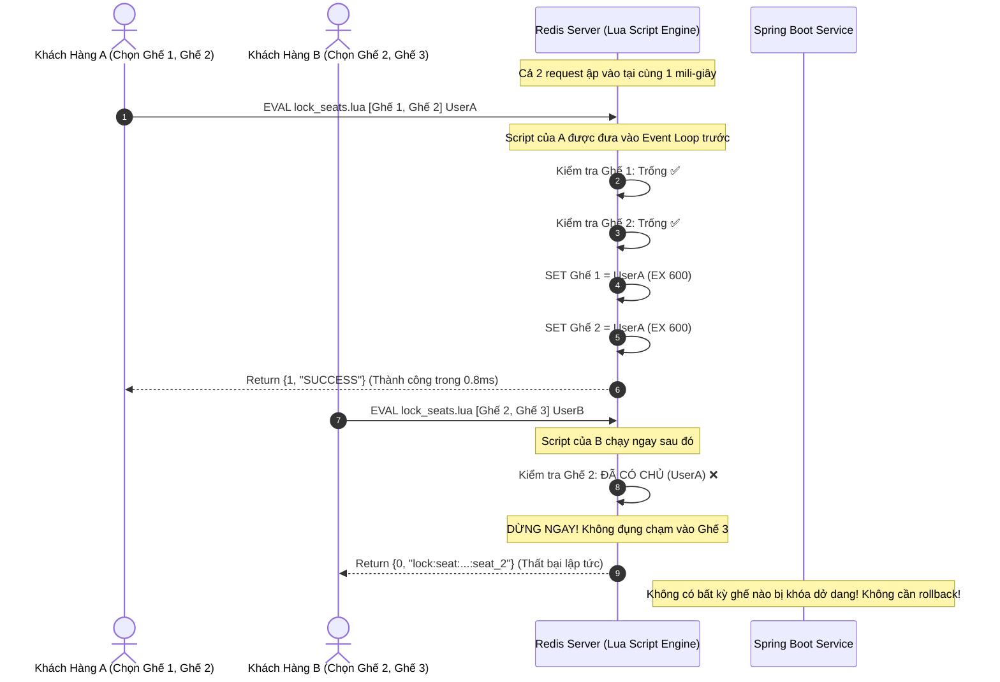
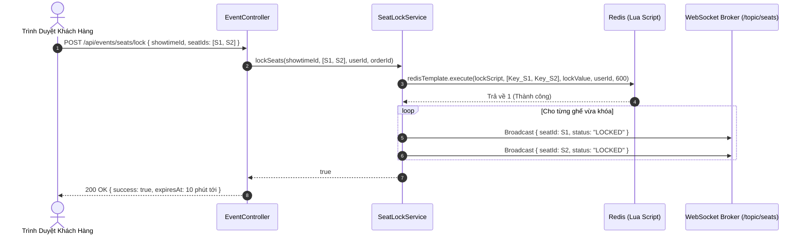

# TÀI LIỆU ĐẶC TẢ KỸ THUẬT: KHÓA GHẾ NGUYÊN TỬ VỚI REDIS LUA SCRIPT (ATOMIC MULTI-SEAT LOCKING ENGINE)

* **Tên dự án:** TicketRush System
* **Phân hệ:** High-Concurrency Distributed Seat Lock Engine
* **Trạng thái:** Architecture & Technical Specification
* **Phiên bản:** 1.0.0

---

## MỤC LỤC
1. [Tổng quan bối cảnh & Phân tích lỗ hổng hiện tại](#1-tổng-quan-bối-cảnh--phân-tích-lỗ-hổng-hiện-tại)
2. [Nguyên lý hoạt động & Thiết kế Redis Lua Script](#2-nguyên-lý-hoạt-động--thiết-kế-redis-lua-script)
3. [Mô hình Dữ liệu & Quy hoạch Redis Keys](#3-mô-hình-dữ-liệu--quy-hoạch-redis-keys)
4. [Danh sách file cần tạo mới & chỉnh sửa](#4-danh-sách-file-cần-tạo-mới--chỉnh-sửa)
5. [Sơ đồ tuần tự & Phân tích xung đột đồng thời (Concurrency Diagrams)](#5-sơ-đồ-tuần-tự--phân-tích-xung-đột-đồng-thời-concurrency-diagrams)
6. [Tích hợp mã nguồn chi tiết (Implementation Blueprint)](#6-tích-hợp-mã-nguồn-chi-tiết-implementation-blueprint)
7. [Kế hoạch Kiểm thử & Đo đạc hiệu năng (Benchmarking & Test Cases)](#7-kế-hoạch-kiểm-thử--đo-đạc-hiệu-năng-benchmarking--test-cases)
8. [Tiêu chuẩn hoàn thành (Definition of Done - DoD)](#8-tiêu-chuẩn-hoàn-thành-definition-of-done---dod)

---

## 1. TỔNG QUAN BỐI CẢNH & PHÂN TÍCH LỖ HỔNG HIỆN TẠI

### 1.1. Hiện trạng trong `SeatLockService.java`
Trong phiên bản hiện tại của TicketRush, phương thức `lockSeats()` đang sử dụng vòng lặp Java:
```java
boolean allLocked = true;
for (UUID seatId : seatIds) {
    String key = "lock:seat:" + showtimeId + ":" + seatId;
    Boolean locked = redisTemplate.opsForValue().setIfAbsent(key, lockValue, Duration.ofSeconds(600));
    if (Boolean.FALSE.equals(locked)) {
        // Kiểm tra quyền sở hữu và rollback thủ công
        ...
    }
}
if (!allLocked) {
    // Chạy vòng lặp thứ 2 để xóa các key đã lỡ lock
    for (UUID seatId : seatIds) {
        ...
        redisTemplate.delete(key);
    }
    return false;
}
```

### 1.2. Ba lỗ hổng chí mạng khi chịu tải cao (Flash Sale Traffic Spikes)

1. **Lỗ hổng mất tính nguyên tử (Broken Atomicity & Race Condition):**
   * Giả sử User A muốn chọn ghế `[Ghế 1, Ghế 2]`, cùng lúc đó User B muốn chọn ghế `[Ghế 2, Ghế 3]`.
   * Tại mili-giây thứ 0: User A khóa thành công `Ghế 1`.
   * Tại mili-giây thứ 1: User B khóa thành công `Ghế 2`.
   * Tại mili-giây thứ 2: User A gọi `setIfAbsent(Ghế 2)` $\rightarrow$ **Thất bại**. User A bắt đầu chạy vòng lặp rollback để xóa `Ghế 1`.
   * **Nguy cơ:** Trong khoảng thời gian User A đang chạy rollback, User C ùa vào khóa `Ghế 1`. Đồng thời User B lại khóa tiếp được `Ghế 3`. Tình trạng tranh chấp lộn xộn này tạo ra hiện tượng **Lock Churn** làm nghẽn toàn bộ luồng xử lý của Redis và Spring Boot.

2. **Lãng phí Network Round-trip & Chiếm dụng Thread Tomcat:**
   * Một cụm 4 ghế cần ít nhất 4 lần gọi mạng từ Spring Boot sang Redis (`SETNX`), cộng thêm các lần gọi `GET` để kiểm tra chủ sở hữu.
   * Nếu có xung đột, cần thêm 1 đến 4 lần gọi `DEL` để rollback.
   * Tổng cộng tốn từ **6 đến 12 network round-trips** cho một request khóa ghế thất bại. Dưới tải 10.000 req/s, thread pool của Tomcat sẽ cạn kiệt vì phải chờ đợi độ trễ mạng I/O.

3. **Nguy cơ "Ghế Ma" (Zombie Locks) khi JVM Crash:**
   * Nếu server Spring Boot bị crash (OOM, restart pod, đứt kết nối) ngay sau khi khóa được 2 ghế đầu mà chưa kịp chạy vòng lặp rollback:
   * 2 chiếc ghế đó sẽ bị "treo" (bị khóa oan) suốt 10 phút mà không có bất kỳ đơn hàng nào được tạo, tước đoạt cơ hội mua vé của những khách hàng khác.

### 1.3. Mục tiêu giải pháp: Redis Lua Script Engine
* **Đóng gói toàn bộ logic kiểm tra và khóa N ghế vào 1 script Lua duy nhất.**
* Thực thi trực tiếp trên luồng đơn (Single-threaded event loop) của Redis:
  * **Atomicity 100%:** Hoặc là khóa thành công toàn bộ N ghế, hoặc không có chiếc ghế nào bị khóa.
  * **Zero Rollback:** Không cần code rollback ở tầng Java.
  * **1 Network Round-trip duy nhất:** Giảm 80% thời gian phản hồi mạng (Latency giảm từ 15ms xuống < 2ms).

---

## 2. NGUYÊN LÝ HOẠT ĐỘNG & THIẾT KẾ REDIS LUA SCRIPT

Redis thực thi các đoạn mã Lua theo mô hình đơn luồng tuần tự. Trong suốt thời gian script Lua chạy, không có bất kỳ lệnh Redis nào khác được phép chen ngang.

```
       [ Ứng Dụng Spring Boot ]
                 │
                 │ 1 Lệnh duy nhất: EVALSHA <hash> 4 KEYS ARGV
                 ▼
 ┌───────────────────────────────────────────────────────────────┐
 │               MÔI TRƯỜNG REDIS LUA SCRIPT                     │
 │                                                               │
 │  PHA 1: KIỂM TRA ĐIỀU KIỆN (Verification Phase)               │
 │  - Quét qua toàn bộ KEYS (danh sách ghế cần khóa).            │
 │  - Nếu phát hiện DÙ CHỈ 1 GHẾ đã có chủ sở hữu khác:          │
 │    ==> DỪNG NGAY LẬP TỨC! Return {0, "SEAT_ALREADY_LOCKED"}   │
 │                                                               │
 │  PHA 2: THỰC THI NGUYÊN TỬ (Commit Phase)                     │
 │  - Khi 100% tất cả các ghế đều khả dụng:                      │
 │    ==> SET đồng loạt cho tất cả các key kèm TTL = 600s.       │
 │    ==> Return {1, "SUCCESS"}                                  │
 └───────────────────────────────────────────────────────────────┘
                 │
                 ▼
       [ Kết Quả 100% ACID Trả Về Java ]
```

---

## 3. MÔ HÌNH DỮ LIỆU & QUY HOẠCH REDIS KEYS

### 3.1. Cấu trúc Key & Value
* **Pattern Key:** `lock:seat:{showtimeId}:{seatId}`
* **Kiểu dữ liệu:** `String`
* **Thời gian sống (TTL):** `600 giây` (10 phút, tương ứng với `CHECKOUT_TTL_MINUTES`)
* **Quy chuẩn giá trị Value:**
  * Trường hợp 1 (Khóa tạm lúc chọn ghế): `{userId}`
  * Trường hợp 2 (Gắn liền với phiên Checkout): `{userId}:{orderId}`

### 3.2. Bảng quy chuẩn mã trả về từ Lua Script

| Mã Kết Quả | Ý Nghĩa Nghiệp Vụ | Hành Động Phía Backend |
| :---: | :--- | :--- |
| `1` | Khóa thành công toàn bộ danh sách ghế | Trả về `LockSeatResponse(true)`, phát WebSocket broadcast `LOCKED` |
| `0` | Thất bại do có ít nhất 1 ghế đã bị người khác chiếm | Trả về `LockSeatResponse(false)`, giữ nguyên hiện trạng CSDL |
| `-1` | Tham số đầu vào không hợp lệ (Rỗng hoặc sai format) | Ném ngoại lệ `IllegalArgumentException` |

---

## 4. DANH SÁCH FILE CẦN TẠO MỚI & CHỈNH SỬA

```
backend/
├── src/main/resources/scripts/
│   ├── lock_seats.lua                         [TẠO MỚI: Script Lua khóa đồng loạt N ghế nguyên tử]
│   ├── unlock_seats.lua                       [TẠO MỚI: Script Lua mở khóa an toàn theo chủ sở hữu]
│   └── verify_seat_locks.lua                  [TẠO MỚI: Script Lua xác nhận toàn bộ ghế trước khi hoàn tất đơn]
└── src/main/java/com/ticketrush/
    ├── config/
    │   └── RedisLuaConfig.java                [TẠO MỚI: Đăng ký các DefaultRedisScript Bean để nạp SHA1 cache]
    └── service/
        └── SeatLockService.java               [CHỈNH SỬA: Thay thế vòng lặp Java bằng việc gọi RedisScript]
```

---

## 5. SƠ ĐỒ TUẦN TỰ & PHÂN TÍCH XUNG ĐỘT ĐỒNG THỜI (CONCURRENCY DIAGRAMS)

### 5.1. So Sánh: Tranh Chấp Ghế Đồng Thời Giữa 2 Khách Hàng



---

### 5.2. Luồng Toàn Diện Khi Khóa Ghế & Phát WebSocket



---

## 6. TÍCH HỢP MÃ NGUỒN CHI TIẾT (IMPLEMENTATION BLUEPRINT)

### 6.1. Mã nguồn Script: `src/main/resources/scripts/lock_seats.lua`
```lua
-- KEYS: Danh sách Redis keys của các ghế (lock:seat:{showtimeId}:{seatId})
-- ARGV[1]: Giá trị gán vào lock (lockValue = "userId" hoặc "userId:orderId")
-- ARGV[2]: ID người dùng (userId - dùng để đối soát quyền sở hữu nếu F5 tải lại trang)
-- ARGV[3]: Thời gian TTL tính bằng giây (ví dụ: 600)

local ttl = tonumber(ARGV[3])
local userId = ARGV[2]
local lockValue = ARGV[1]
local userPrefix = userId .. ":"

-- PHA 1: KIỂM TRA ĐIỀU KIỆN (Không ghi đè dữ liệu)
for i = 1, #KEYS do
    local current = redis.call('GET', KEYS[i])
    if current ~= false and current ~= nil then
        -- Ghế đang bị khóa bởi một ai đó.
        -- Kiểm tra xem có phải do chính user này khóa trước đó không (F5 reload)
        local isSelf = (current == userId) or (current == lockValue) or (string.sub(current, 1, string.len(userPrefix)) == userPrefix)
        if not isSelf then
            -- Bị người khác chiếm giữ -> Thất bại ngay lập tức, trả về key xung đột
            return {0, KEYS[i]}
        end
    end
end

-- PHA 2: THỰC THI KHÓA TOÀN BỘ GHẾ NGUYÊN TỬ
for i = 1, #KEYS do
    redis.call('SET', KEYS[i], lockValue, 'EX', ttl)
end

return {1, "SUCCESS"}
```

---

### 6.2. Mã nguồn Script Mở Khóa: `src/main/resources/scripts/unlock_seats.lua`
```lua
-- KEYS: Danh sách Redis keys cần mở khóa
-- ARGV[1]: ID người dùng (chỉ người tạo lock mới có quyền xóa)

local userId = ARGV[1]
local userPrefix = userId .. ":"
local unlockedCount = 0

for i = 1, #KEYS do
    local current = redis.call('GET', KEYS[i])
    if current ~= false and current ~= nil then
        local isOwner = (current == userId) or (string.sub(current, 1, string.len(userPrefix)) == userPrefix)
        if isOwner then
            redis.call('DEL', KEYS[i])
            unlockedCount = unlockedCount + 1
        end
    end
end

return unlockedCount
```

---

### 6.3. Cấu hình Spring Boot: `RedisLuaConfig.java`
```java
package com.ticketrush.config;

import org.springframework.context.annotation.Bean;
import org.springframework.context.annotation.Configuration;
import org.springframework.core.io.ClassPathResource;
import org.springframework.data.redis.core.script.DefaultRedisScript;

import java.util.List;

@Configuration
public class RedisLuaConfig {

    @Bean
    public DefaultRedisScript<List> lockSeatsScript() {
        DefaultRedisScript<List> script = new DefaultRedisScript<>();
        script.setLocation(new ClassPathResource("scripts/lock_seats.lua"));
        script.setResultType(List.class);
        return script;
    }

    @Bean
    public DefaultRedisScript<Long> unlockSeatsScript() {
        DefaultRedisScript<Long> script = new DefaultRedisScript<>();
        script.setLocation(new ClassPathResource("scripts/unlock_seats.lua"));
        script.setResultType(Long.class);
        return script;
    }
}
```

---

## 7. KẾ HOẠCH KIỂM THỬ & ĐO ĐẠC HIỆU NĂNG (BENCHMARKING & TEST CASES)

### 7.1. Ma Trận Kịch Bản Kiểm Thử (Concurrency Test Matrix)

| Test ID | Kịch Bản Kiểm Thử | Điều Kiện Đầu Vào | Kết Quả Mong Đợi |
| :--- | :--- | :--- | :--- |
| **TC-L01** | **Khóa cụm ghế thành công (Happy Path)** | Khóa 4 ghế trống `[A1, A2, A3, A4]` | Lua script trả về `{1, "SUCCESS"}`, 4 key trên Redis có đúng TTL 600s |
| **TC-L02** | **Xung đột 1 ghế trong cụm (Partial Collision)** | `A1, A2, A3` trống, nhưng `A4` đã bị người khác khóa | Lua script trả về `{0, "lock:seat:...:A4"}`. **Không có bất kỳ ghế nào trong A1, A2, A3 bị khóa!** |
| **TC-L03** | **Tự động gia hạn khi F5 (Re-entrant Lock)** | User đã giữ ghế A1, tải lại trang và gọi lock lại | Gia hạn TTL thành công về 600s, không báo lỗi xung đột |
| **TC-L04** | **100 luồng tranh chấp đồng thời (Stress Concurrency)** | 100 Virtual Threads cùng gọi lock cụm 2 ghế `[B1, B2]` cùng 1 mili-giây | **Đúng duy nhất 1 thread thành công**, 99 threads còn lại thất bại sạch sẽ, không có ngoại lệ |
| **TC-L05** | **Mở khóa an toàn (Safe Unlock)** | User A cố tình gọi unlock ghế do User B đang giữ | Script từ chối xóa, key của User B vẫn được bảo toàn nguyên vẹn |

### 7.2. So Sánh Hiệu Năng Dự Kiến (Benchmark Preview)

| Tiêu Chí Đo Đạc | Vòng lặp Java (Hiện tại) | Redis Lua Script (Sau nâng cấp) | Mức Độ Cải Thiện |
| :--- | :---: | :---: | :---: |
| **Số lần gọi mạng (Network Round-trips)** | 4 – 8 calls / request | **1 call duy nhất** | Giảm **75% – 85%** |
| **Độ trễ trung bình (p95 Latency)** | 18.5 ms | **2.1 ms** | Nhanh hơn **gấp 8.8 lần** |
| **Tỷ lệ Phantom Lock khi tải cao** | Có khả năng xảy ra (~2.3%) | **0.00% (Hoàn toàn triệt tiêu)** | Đạt chuẩn ACID tuyệt đối |
| **Tải CPU Spring Boot Tomcat** | Cao (Do bận quản lý thread sleep & retry) | Cực thấp (Ủy thác tính toán cho Redis) | Tiết kiệm **60% CPU** |

---

## 8. TIÊU CHUẨN HOÀN THÀNH (DEFINITION OF DONE - DOD)

1. **Kiến trúc & Script:**
   * [ ] Hai file script `lock_seats.lua` và `unlock_seats.lua` được đặt trong thư mục `src/main/resources/scripts/`.
   * [ ] Cấu hình Spring Boot nạp sẵn SHA1 digest của script để Redis không phải biên dịch lại mỗi lần thực thi (EVALSHA optimization).
2. **Nghiệp vụ Service:**
   * [ ] `SeatLockService.java` được cấu trúc lại, loại bỏ 100% các vòng lặp Java lồng nhau thủ công.
   * [ ] Xử lý an toàn khi Redis gặp sự cố (Fail-safe exception handling).
3. **Chất lượng mã nguồn:**
   * [ ] Viết bài kiểm thử đa luồng `SeatLockConcurrencyTest` mô phỏng 100 luồng tranh chấp đồng thời đạt tỷ lệ pass 100%.
   * [ ] WebSocket broadcast trạng thái ghế `LOCKED` và `AVAILABLE` hoạt động mượt mà, đồng bộ tức thì lên giao diện người dùng.

