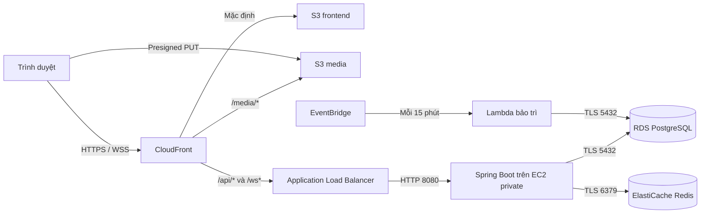

# Thiết kế hạ tầng AWS cho TicketRush Demo

## Phạm vi và mục tiêu

Triển khai môi trường `demo` của TicketRush tại `ap-southeast-1` (Singapore), phục vụ người dùng qua `https://ticketrush.sudothanh.me`. Hạ tầng cần đáp ứng ba yêu cầu:

- **Phân phối ứng dụng qua một tên miền.** CloudFront phục vụ giao diện, API, WebSocket và nội dung media. Trình duyệt tải media lên S3 qua URL ký trước.
- **Cô lập ứng dụng và dữ liệu.** Đặt backend và dịch vụ dữ liệu trong subnet private. Dùng hai Availability Zones cho tầng ứng dụng, PostgreSQL và Redis.
- **Giới hạn quy mô cho demo.** Dùng một NAT Gateway chung để giảm chi phí. Cho phép backend tự tăng giảm trong khoảng 2–4 EC2 và theo dõi tải qua CloudWatch.

Dùng Terraform để triển khai các yêu cầu và thông số dưới đây. Môi trường triển khai có tên `demo` và tiền tố tài nguyên `ticketrush-demo`.

## Kiến trúc tổng thể

CloudFront kết nối ALB qua HTTPS. Backend kết nối trực tiếp tới PostgreSQL và Redis trong tầng dữ liệu. Lambda chạy riêng trong tầng ứng dụng để xử lý các tác vụ bảo trì theo lịch.

## Mạng — `network`

Tạo VPC IPv4 `10.0.0.0/16`, bật DNS support và DNS hostnames. Chọn hai AZ khả dụng đầu tiên từ tập AZ AWS trả về, bỏ các AZ yêu cầu opt-in. Dùng dải IPv6 do AWS cấp cho VPC để chia subnet IPv6 cho tầng public.

| Tầng | AZ thứ nhất | AZ thứ hai | Route mặc định |
| --- | --- | --- | --- |
| Public | `10.0.0.0/24` | `10.0.1.0/24` | `0.0.0.0/0` và `::/0` qua Internet Gateway |
| Private app | `10.0.10.0/24` | `10.0.11.0/24` | `0.0.0.0/0` qua NAT Gateway |
| Private data | `10.0.20.0/24` | `10.0.21.0/24` | Chỉ dùng route nội bộ VPC |

Đặt ALB internet-facing trong hai subnet public và đặt một NAT Gateway ở AZ thứ nhất. Cả hai subnet app dùng chung NAT cho lưu lượng đi ra. Phương án này giữ chi phí demo thấp và khiến lưu lượng ra Internet của tầng app phụ thuộc vào NAT đó. Gắn S3 Gateway Endpoint vào route table của hai subnet app. Giữ interface endpoints ở trạng thái tắt.

## Quyền truy cập — `security`

Dùng security group để giới hạn các luồng giữa các tầng. EC2 backend chạy trong subnet private app và nhận yêu cầu ứng dụng từ ALB.

| Luồng | Giao thức và cổng | Phạm vi |
| --- | --- | --- |
| CloudFront → ALB | TCP `443` | AWS managed prefix list `com.amazonaws.global.cloudfront.origin-facing` |
| ALB → EC2 app | TCP `8080` | ALB security group → app security group |
| EC2 app → PostgreSQL | TCP `5432` | App security group → DB security group |
| EC2 app → Redis | TCP `6379` | App security group → Redis security group |
| Lambda worker → PostgreSQL | TCP `5432` | Lambda security group → DB security group |

Cho phép EC2 và Lambda gửi HTTPS TCP `443` tới `0.0.0.0/0` và DNS TCP/UDP `53` tới CIDR VPC. EC2 được gửi NTP UDP `123` tới Amazon Time Sync `169.254.169.123/32`.

Gắn instance profile `ticketrush-demo-ec2` cho backend. Role cần quyền đọc ECR, dùng Systems Manager, đọc secrets theo tiền tố `ticketrush-demo/`, đọc tham số SSM `image-tag`, truy cập bucket media, ghi CloudWatch Logs và gửi metric ứng dụng trong namespace `TicketRush`. Dùng role riêng cho Lambda, giới hạn quyền đọc Secrets Manager vào secret của PostgreSQL và cấp quyền chạy Lambda trong VPC.

## Backend — `compute`

| Thông số | Giá trị thiết kế |
| --- | --- |
| EC2 | `t3.small`, Amazon Linux 2023 `x86_64` |
| Root volume | 30 GiB `gp3`, mã hóa và xóa khi kết thúc instance |
| Instance metadata | Bắt buộc IMDSv2, hop limit `2` |
| ASG tối thiểu / khởi tạo / tối đa | `2 / 2 / 4` |
| Auto Scaling theo tải | Target Tracking, mục tiêu CPU trung bình `70%`, warm-up `300` giây |
| Theo dõi sức khỏe ASG | ELB health check, grace period `300` giây, thời gian chờ capacity `10m` |
| Rolling instance refresh | Tối thiểu `50%` máy khỏe, warm-up `120` giây |
| Log backend | `/ticketrush/demo/backend`, giữ 14 ngày |

Để AWS quản lý số máy mong muốn khi bật Target Tracking. ASG mới khởi tạo ở mức tối thiểu. Trong Terraform, đặt giới hạn trên và dưới, đồng thời để trống `desired_capacity` khi bật policy để tránh đặt lại số máy ở lần apply sau. Khi cần vận hành theo số máy cố định, đặt `asg_cpu_target_utilization = null` và đặt số máy qua `asg_desired_capacity`. Cảnh báo CPU qua SNS được cấu hình riêng với policy scaling.

Đóng gói Spring Boot thành container chạy trên cổng `8080`. Dùng ECR riêng tư `ticketrush-demo-backend` với tag mutable, mã hóa `AES256` và scan khi push. Giữ 15 image tagged gần nhất và xóa image untagged sau 7 ngày tính từ lúc push. Bật `force_delete` cho ECR của demo.

Lưu tag khởi tạo `latest` trong SSM tại `/ticketrush/demo/image-tag`. Sau khi khởi tạo, workflow phát hành backend quản lý giá trị tham số này. Lúc boot, EC2 đọc tag từ SSM và đọc bí mật từ Secrets Manager. Cho phép tối đa 30 lần pull image, cách nhau 10 giây, rồi chạy container và gửi log qua `awslogs`. Bật bootstrap admin và tắt cơ chế reset mật khẩu admin lúc boot.

## Tầng dữ liệu — `data`

### PostgreSQL

| Thông số | Giá trị thiết kế |
| --- | --- |
| Engine và cổng | RDS PostgreSQL `16`, `5432` |
| Instance class | `db.t4g.micro` |
| Database và tài khoản DB chính | `ticketrush` |
| Storage | `gp3` mã hóa, bắt đầu 20 GiB, tự mở rộng tối đa 100 GiB |
| Triển khai | Multi-AZ, subnet private data, tắt public access |
| Automated backup | Giữ 7 ngày, cửa sổ `03:00–04:00` UTC |
| Bảo trì | Chủ nhật `04:00–05:00` UTC, bật auto minor upgrades |
| Snapshot | Sao chép tags, bỏ qua final snapshot khi xóa |
| Deletion protection | Tắt để có thể tháo dỡ môi trường demo |

Backend dùng endpoint RDS trực tiếp với JDBC `sslmode=require`. Lambda cũng kết nối PostgreSQL qua TLS.

### Redis

Dùng ElastiCache Redis `7.1` trên cổng `6379`, gồm một primary và một replica trên hai AZ. Mỗi node dùng `cache.t4g.micro`. Bật automatic failover, mã hóa dữ liệu lưu trữ, TLS và auth token với update strategy `ROTATE`.

Dùng parameter group `ticketrush-demo-redis7` thuộc family `redis7`. Đặt `maxmemory-policy=noeviction` để Redis giữ các khóa đang dùng. Bật `notify-keyspace-events=Ex` để ứng dụng nhận sự kiện hết hạn. Giữ snapshot tự động 5 ngày, với cửa sổ `02:00–03:00` UTC. Đặt lịch bảo trì Chủ nhật `05:00–06:00` UTC. Bật auto minor upgrades và `apply_immediately`.

### Bí mật ứng dụng

Dùng Secrets Manager để lưu riêng DB credentials, Redis token, khóa ký JWT, khóa ký vé và mật khẩu admin dưới tiền tố `ticketrush-demo/`. Đặt recovery window `0` ngày cho demo. Khi triển khai qua GitHub Actions, lấy mật khẩu admin từ secret `ADMIN_PASSWORD`. Khi chạy Terraform cục bộ, truyền `admin_password` rỗng nếu muốn Terraform sinh mật khẩu ngẫu nhiên.

## DNS, CDN và cân bằng tải — `edge`

**DNS và HTTPS.** Tạo hosted zone Route 53 cho `ticketrush.sudothanh.me` và delegate NS từ DNS cha. Tạo alias `A` và `AAAA` từ tên miền ứng dụng tới CloudFront. Tạo alias `A` cho `origin.ticketrush.sudothanh.me` tới ALB. Dùng chứng chỉ ACM cho CloudFront tại `us-east-1` và cho ALB tại `ap-southeast-1`. CloudFront chuyển HTTP sang HTTPS và dùng viewer policy `TLSv1.2_2021`.

**ALB.** Dùng IPv4 và idle timeout `3600` giây. Tắt deletion protection để có thể tháo dỡ demo. Mở listener HTTPS `443` với `ELBSecurityPolicy-TLS13-1-2-2021-06`. CloudFront chèn `X-Origin-Verify` khi gọi origin. Listener chỉ chuyển tiếp yêu cầu có giá trị header đúng và trả `403` cho yêu cầu còn lại. Lưu giá trị header trong SSM `SecureString` tại `/ticketrush/demo/origin-verify`.

Target group chuyển HTTP tới cổng `8080` theo round robin và có deregistration delay `30` giây. Kiểm tra `/actuator/health/readiness` mỗi `15` giây. Mã đạt yêu cầu là `200`, timeout `5` giây và ngưỡng khỏe hoặc lỗi đều là `3` lần kiểm tra liên tiếp.

**CloudFront.** Dùng `PriceClass_200`, bật IPv6, HTTP/2 và HTTP/3. Kết nối ALB custom origin qua HTTPS với read timeout `120` giây và keep-alive `5` giây. Giữ AWS WAF ở trạng thái tắt cho demo.

| Đường dẫn | Origin | Cấu hình cache và chuyển tiếp |
| --- | --- | --- |
| Mặc định | S3 frontend | `Managed-CachingOptimized` |
| `/media/*` | S3 media | `Managed-CachingOptimized` |
| `/api/*` | ALB | `Managed-CachingDisabled`, `Managed-AllViewerExceptHostHeader` |
| `/ws*` | ALB | `Managed-CachingDisabled`, `Managed-AllViewerExceptHostHeader`, tắt nén |

Dùng CloudFront Function ở behavior frontend để đưa route SPA không có phần mở rộng về `/index.html` và giữ nguyên phản hồi lỗi của API. Áp dụng CSP, HSTS một năm, `X-Frame-Options: DENY`, content-type options và referrer policy.

**S3.** Tạo hai bucket riêng tư với tiền tố `ticketrush-demo-frontend-` và `ticketrush-demo-media-`. Bật Block Public Access, `BucketOwnerEnforced` và SSE-S3 `AES256`. Mỗi bucket cho phép distribution đọc object qua OAC ký SigV4 và giới hạn bucket policy theo ARN của distribution.

Cho phép tải lên bucket media qua presigned PUT. CORS cho phép `https://ticketrush.sudothanh.me` và `http://localhost:5173` đối với `GET`, `PUT`, `HEAD` và `POST`, expose `ETag`, cache preflight `3000` giây. Dùng hai origin này cho CORS và WebSocket của backend. Bật `force_destroy` cho hai bucket và hosted zone để tháo dỡ demo.

## Giám sát và cảnh báo — `observability`

Tạo dashboard CloudWatch `ticketrush-demo-overview` để theo dõi lượt yêu cầu, lỗi ALB, số target khỏe, thời gian phản hồi và CPU của các tầng. Gửi chuyển trạng thái ALARM và OK tới SNS `ticketrush-demo-alerts`. Khi có `alarm_email`, tạo subscription và yêu cầu người nhận xác nhận. Dùng `treat_missing_data = "notBreaching"` cho các cảnh báo sau.

| Tín hiệu | Thống kê và ngưỡng | Số kỳ và độ dài mỗi kỳ |
| --- | --- | --- |
| ALB 5xx | `Sum ≥ 20` | 1 kỳ × 5 phút |
| Thời gian phản hồi của target | `Average > 2` giây | 2 kỳ × 5 phút |
| Target không khỏe | `Maximum ≥ 1` | 2 kỳ × 1 phút |
| CPU EC2 theo ASG | `Average > 70%` | 3 kỳ × 5 phút |
| CPU RDS | `Average > 80%` | 3 kỳ × 5 phút |
| Redis engine CPU | `Average > 75%` | 3 kỳ × 5 phút |

## Tác vụ bảo trì — `maintenance_worker`

Dùng EventBridge gọi Lambda định kỳ để xử lý dữ liệu hết hạn trong PostgreSQL. Lambda chuyển đơn `PENDING` quá hạn sang `EXPIRED`, xóa vé thuộc đơn `EXPIRED`, giải phóng ghế `LOCKED` quá 15 phút và tắt voucher hết hạn hoặc hết quota. Thực hiện các thao tác trong một transaction.

| Thông số | Giá trị thiết kế |
| --- | --- |
| Lambda và handler | `ticketrush-demo-maintenance-worker`, `maintenance.handler` |
| Runtime và kiến trúc | Python `3.12`, `x86_64` |
| Bộ nhớ và timeout | 128 MB, 30 giây |
| Lịch EventBridge | `rate(15 minutes)` |
| Reserved concurrency | `-1` để dùng concurrency chung, phù hợp quota của tài khoản demo |
| Mạng và quyền | Hai subnet private app, Lambda security group và quyền đọc DB secret |
| Log group và retention | `/aws/lambda/ticketrush-demo-maintenance-worker`, 14 ngày |
| Đóng gói | Zip chứa handler và `psycopg2`. Hỗ trợ layer qua `psycopg2_layer_arn` |

## Tổ chức triển khai bằng Terraform

Tách stack `bootstrap` để chuẩn bị state và quyền CI/CD. Root module `infra/terraform/envs/demo` triển khai môi trường demo bằng bảy module nêu trên. Cấu hình provider khu vực chính tại `ap-southeast-1` và alias `us_east_1` cho chứng chỉ CloudFront. Đặt yêu cầu Terraform tối thiểu `1.6.0` và dùng `1.16.6` trong GitHub Actions.

| Thành phần | Yêu cầu triển khai |
| --- | --- |
| State bootstrap | State cục bộ, lưu riêng với stack demo |
| State demo | Backend S3 mã hóa, khóa `ticketrush/demo/terraform.tfstate` |
| Bucket state | Tên truyền qua `state_bucket_name`, bật versioning, Block Public Access, `BucketOwnerEnforced` và `AES256`. Yêu cầu HTTPS và TLS từ `1.2`. Hủy multipart upload chưa hoàn tất sau 7 ngày, xóa version noncurrent sau 90 ngày |
| State locking | DynamoDB `ticketrush-terraform-locks`, `PAY_PER_REQUEST`, partition key kiểu chuỗi `LockID`. Bật mã hóa và point-in-time recovery |
| GitHub Actions OIDC | Audience `sts.amazonaws.com`. Role `ticketrush-github-deploy` tin cậy subject của repo cho nhánh `main` đối với job chạy ngoài Environment và subject cho GitHub Environment `demo` đối với job triển khai demo |
| Quyền triển khai | Role bootstrap dùng `PowerUserAccess`, `IAMFullAccess` và policy riêng cho state bucket và lock table trong tài khoản demo |

Khi khởi tạo backend, truyền bucket, khóa state, region backend và tên bảng lock của đúng môi trường. Dùng Terraform outputs để lấy tên bucket, endpoint, resource ID và ARN mà quy trình triển khai cần sử dụng. Chuẩn bị DNS delegation, gói Lambda và image ECR đầu tiên trước khi chạy full plan và apply. Xem [trình tự triển khai AWS](AWS_DEPLOY.md) và [cấu hình Terraform demo](../infra/terraform/envs/demo/main.tf).
