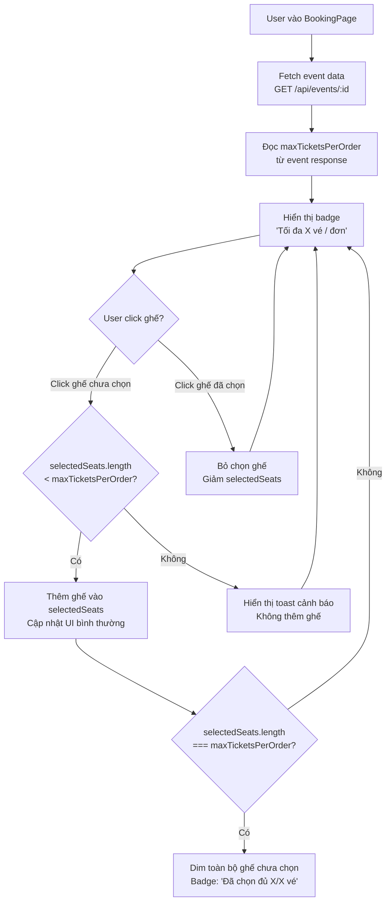

# TÀI LIỆU ĐẶC TẢ KỸ THUẬT: GIỚI HẠN SỐ VÉ MUA THỰC TẾ TRONG UI ĐẶT CHỖ

* **Tên dự án:** TicketRush System
* **Phân hệ:** Customer Booking Flow — Seat Selection Guard
* **Trạng thái:** Architecture & Technical Specification
* **Phiên bản:** 1.0.0

---

## MỤC LỤC
1. [Tổng quan & Phân tích lỗ hổng hiện tại](#1-tổng-quan--phân-tích-lỗ-hổng-hiện-tại)
2. [Thiết kế giải pháp](#2-thiết-kế-giải-pháp)
3. [Danh sách file cần chỉnh sửa](#3-danh-sách-file-cần-chỉnh-sửa)
4. [Sơ đồ luồng kiểm soát](#4-sơ-đồ-luồng-kiểm-soát)
5. [Tích hợp mã nguồn chi tiết (Implementation Blueprint)](#5-tích-hợp-mã-nguồn-chi-tiết-implementation-blueprint)
6. [Kế hoạch Kiểm thử](#6-kế-hoạch-kiểm-thử)
7. [Tiêu chuẩn hoàn thành (Definition of Done - DoD)](#7-tiêu-chuẩn-hoàn-thành-definition-of-done---dod)

---

## 1. TỔNG QUAN & PHÂN TÍCH LỖ HỔNG HIỆN TẠI

### 1.1. Trường `maxTicketsPerOrder` đang bị bỏ qua hoàn toàn

Backend `Event` entity đã có trường này từ migration `V1__init.sql`:

```sql
max_tickets_per_order INTEGER NOT NULL DEFAULT 4
```

Admin có thể chỉnh giá trị qua form edit trong `AdminEventsList.jsx`. Nhưng **frontend hoàn toàn không sử dụng** giá trị này khi customer đang chọn ghế.

### 1.2. Ba điểm bị hardcode hoặc thiếu guard

**Điểm 1: `BookingPage.jsx` — Không giới hạn số ghế chọn**

Customer có thể chọn **bất kỳ số lượng ghế nào** mà không có giới hạn, chỉ bị backend chặn khi gọi `POST /api/orders/checkout`.

**Điểm 2: `WaitingRoomPage.jsx` — Hardcode "04 Vé"**

```jsx
// Dòng 242 trong WaitingRoomPage.jsx — HARDCODE!
{ icon: ShoppingCart, label: "Giới hạn vé", value: "04 Vé" },
```

Nếu Admin set `maxTicketsPerOrder = 2` cho sự kiện VIP, trang phòng chờ vẫn hiện "04 Vé" — sai hoàn toàn.

**Điểm 3: Thông báo lỗi từ backend 400 không rõ ràng**

Khi customer vượt giới hạn, backend trả về `400 Bad Request` nhưng không có message tiếng Việt rõ ràng. Frontend chỉ in ra lỗi Axios chung chung.

### 1.3. Mục tiêu tính năng

| Điểm cần sửa | Hành động |
| :--- | :--- |
| `BookingPage.jsx` | Thêm guard: disabled nút ghế khi đã chọn đủ `maxTicketsPerOrder` |
| `BookingPage.jsx` | Hiển thị badge "Tối đa X vé/đơn" đúng với giá trị từ event data |
| `WaitingRoomPage.jsx` | Thay "04 Vé" hardcode bằng `event.maxTicketsPerOrder` động |
| `BookingPage.jsx` | Thông báo lỗi tiếng Việt rõ ràng khi backend từ chối |

---

## 2. THIẾT KẾ GIẢI PHÁP

### 2.1. Nguồn dữ liệu

`maxTicketsPerOrder` đã có trong response `GET /api/events/{id}` (thông qua `EventResponse.java`). `BookingPage.jsx` đã fetch event data này, chỉ cần **đọc thêm trường đó**.

> **Không cần thay đổi backend.** Chỉ cần đọc giá trị `event.maxTicketsPerOrder` từ dữ liệu đã có.

### 2.2. Logic Guard trong `BookingPage.jsx`

```
Khi user click ghế:
  if (selectedSeats.length >= event.maxTicketsPerOrder) {
    → Block hành động
    → Hiển thị toast: "Bạn chỉ được chọn tối đa X ghế cho đơn hàng này"
    → Ghế được click KHÔNG được thêm vào selectedSeats
  } else {
    → Thêm ghế vào selectedSeats như bình thường
  }
```

### 2.3. Visual Feedback

- **Badge thông tin:** `"Tối đa {X} vé / đơn"` hiển thị cạnh nút "Tiến hành đặt vé" — luôn hiển thị.
- **Badge trạng thái:** Khi đã chọn đủ: badge chuyển sang màu amber `"Đã chọn đủ {X}/{X} vé"`.
- **Ghế bị disabled:** Khi đã chọn đủ, các ghế chưa chọn bị dim và không thể click.
- **Nút ghế đã chọn:** Vẫn có thể click để **bỏ chọn** (giảm số lượng).

---

## 3. DANH SÁCH FILE CẦN CHỈNH SỬA

```
frontend/
└── src/pages/
    ├── BookingPage.jsx           [CHỈNH SỬA: Thêm maxTickets guard + badge + disabled logic]
    └── WaitingRoomPage.jsx       [CHỈNH SỬA: Thay "04 Vé" hardcode bằng event data]
```

> Không cần thay đổi file nào trong backend.

---

## 4. SƠ ĐỒ LUỒNG KIỂM SOÁT



---

## 5. TÍCH HỢP MÃ NGUỒN CHI TIẾT (IMPLEMENTATION BLUEPRINT)

### 5.1. Thay đổi trong `BookingPage.jsx`

**Bước 1: Đọc `maxTicketsPerOrder` từ event data**

```jsx
// Đã có: const event = ... từ useQuery hoặc useState
const maxTickets = event?.maxTicketsPerOrder ?? 4; // Mặc định 4 nếu chưa có
```

**Bước 2: Guard khi click ghế**

```jsx
const handleSeatClick = (seat) => {
  if (seat.status !== "AVAILABLE") return;

  const isAlreadySelected = selectedSeats.some((s) => s.id === seat.id);

  if (isAlreadySelected) {
    // Cho phép bỏ chọn luôn
    setSelectedSeats((prev) => prev.filter((s) => s.id !== seat.id));
    return;
  }

  // Guard: kiểm tra giới hạn
  if (selectedSeats.length >= maxTickets) {
    toast.warning(`Bạn chỉ được chọn tối đa ${maxTickets} ghế cho mỗi đơn hàng.`);
    return;
  }

  setSelectedSeats((prev) => [...prev, seat]);
};
```

**Bước 3: Disabled visual cho ghế khi đã đủ số lượng**

```jsx
const isAtLimit = selectedSeats.length >= maxTickets;

// Trong JSX render ghế:
<button
  onClick={() => handleSeatClick(seat)}
  disabled={isAtLimit && !isAlreadySelected && seat.status === "AVAILABLE"}
  className={`
    ...existing classes...
    ${isAtLimit && !isAlreadySelected && seat.status === "AVAILABLE"
      ? "opacity-30 cursor-not-allowed"
      : ""}
  `}
>
```

**Bước 4: Badge thông tin**

```jsx
{/* Đặt gần nút "Tiến hành đặt vé" */}
<div className={`inline-flex items-center gap-2 px-3 py-1.5 rounded-full text-xs font-bold
  ${isAtLimit
    ? "bg-amber-100 text-amber-700 border border-amber-200"
    : "bg-slate-100 text-slate-500 border border-slate-200"
  }`}
>
  <Ticket size={12} />
  {isAtLimit
    ? `Đã chọn đủ ${selectedSeats.length}/${maxTickets} vé`
    : `Tối đa ${maxTickets} vé / đơn`
  }
</div>
```

**Bước 5: Xử lý lỗi rõ ràng từ backend**

```jsx
const handleCheckout = async () => {
  try {
    // ... existing checkout logic
  } catch (error) {
    const status = error.response?.status;
    const serverMsg = error.response?.data?.message;

    if (status === 400 && serverMsg?.includes("max")) {
      toast.error(`Vượt quá giới hạn ${maxTickets} vé / đơn. Vui lòng bỏ bớt ghế.`);
    } else {
      toast.error("Lỗi khi đặt chỗ: " + (serverMsg || "Vui lòng thử lại."));
    }
  }
};
```

### 5.2. Thay đổi trong `WaitingRoomPage.jsx`

**Trước (hardcode):**
```jsx
{ icon: ShoppingCart, label: "Giới hạn vé", value: "04 Vé" },
```

**Sau (dynamic):**
```jsx
// event state đã được fetch trong WaitingRoomPage:
{ icon: ShoppingCart, label: "Giới hạn vé", value: `${event?.maxTicketsPerOrder ?? 4} Vé` },
```

---

## 6. KẾ HOẠCH KIỂM THỬ

| Test ID | Kịch Bản | Điều Kiện | Kết Quả Mong Đợi |
| :--- | :--- | :--- | :--- |
| **TC-MAX01** | **Admin set maxTickets = 2, customer chọn ghế** | Sự kiện có maxTicketsPerOrder = 2 | Sau khi chọn 2 ghế, các ghế khác bị dim, không thể click |
| **TC-MAX02** | **Customer cố chọn ghế thứ 3** | Đang có 2 ghế đã chọn, maxTickets = 2 | Hiện toast cảnh báo tiếng Việt, ghế không được thêm |
| **TC-MAX03** | **Bỏ chọn ghế giải phóng slot** | Đang có 2/2 ghế, bỏ chọn 1 | Các ghế khác hiển thị bình thường trở lại, có thể chọn tiếp |
| **TC-MAX04** | **Badge đúng với giá trị admin đã cài** | Admin set maxTickets = 6 | Badge hiển thị "Tối đa 6 vé / đơn" |
| **TC-MAX05** | **WaitingRoom hiển thị đúng** | Sự kiện có maxTickets = 3 | WaitingRoomPage hiển thị "3 Vé" thay vì "04 Vé" |
| **TC-MAX06** | **Vẫn vào được backend nếu bypass UI** | Dùng curl gửi thẳng 10 seatIds | Backend trả về `400` với message rõ ràng |
| **TC-MAX07** | **Event mặc định (maxTickets = 4)** | Không set maxTickets, dùng default | Badge hiển thị "Tối đa 4 vé / đơn" (giá trị mặc định DB) |

---

## 7. TIÊU CHUẨN HOÀN THÀNH (DEFINITION OF DONE - DOD)

- [ ] Không còn hardcode `"04 Vé"` trong `WaitingRoomPage.jsx`.
- [ ] `BookingPage.jsx` đọc `maxTicketsPerOrder` từ event data, không dùng giá trị cứng.
- [ ] Khi chọn đủ số ghế, các ghế còn lại bị disabled (opacity giảm, không click được).
- [ ] Toast cảnh báo tiếng Việt rõ ràng khi cố chọn vượt giới hạn.
- [ ] Badge hiển thị đúng số vé tối đa và chuyển màu amber khi đã đủ.
- [ ] Vẫn có thể bỏ chọn ghế đã chọn để giải phóng slot.
- [ ] Không cần thay đổi backend — toàn bộ logic ở frontend.

