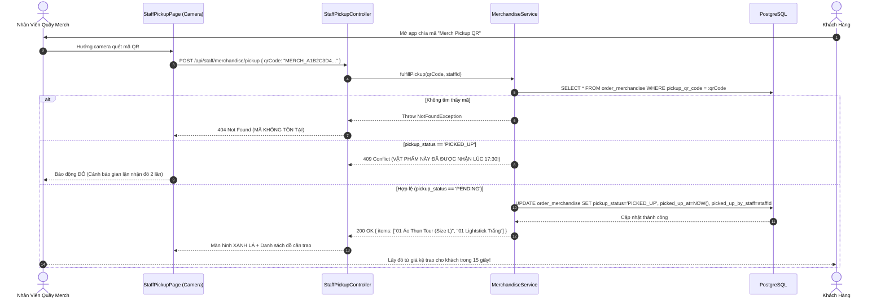

# TÀI LIỆU ĐẶC TẢ KỸ THUẬT: CƠ CHẾ ĐẶT TRƯỚC VẬT PHẨM FANDOM & ĐỒ ĂN THỨC UỐNG (MERCHANDISE & F&B ADD-ON ENGINE)

* **Tên dự án:** TicketRush System
* **Phân hệ:** E-Commerce Add-ons, Fulfillment & Express Pickup Gate
* **Trạng thái:** Architecture & Technical Specification
* **Phiên bản:** 1.0.0

---

## MỤC LỤC
1. [Tổng quan tính năng & Bối cảnh bài toán](#1-tổng-quan-tính-năng--bối-cảnh-bài-toán)
2. [Quy trình nghiệp vụ & Trải nghiệm người dùng](#2-quy-trình-nghiệp-vụ--trải-nghiệm-người-dùng)
3. [Mô hình Dữ liệu (Data Model Changes)](#3-mô-hình-dữ-liệu-data-model-changes)
4. [Danh sách file cần tạo mới & chỉnh sửa](#4-danh-sách-file-cần-tạo-mới--chỉnh-sửa)
5. [Sơ đồ tuần tự (Sequence Diagrams)](#5-sơ-đồ-tuần-tự-sequence-diagrams)
6. [Thiết kế API Chi tiết (API Contracts)](#6-thiết-kế-api-chi-tiết-api-contracts)
7. [Kế hoạch Kiểm thử (Test Cases Matrix)](#7-kế-hoạch-kiểm-thử-test-cases-matrix)
8. [Tiêu chuẩn hoàn thành (Definition of Done - DoD)](#8-tiêu-chuẩn-hoàn-thành-definition-of-done---dod)

---

## 1. TỔNG QUAN TÍNH NĂNG & BỐI CẢNH BÀI TOÁN

### 1.1. Thực trạng tại các sự kiện âm nhạc & thể thao lớn
* **Áp lực xếp hàng quá tải:** Tại các concert quy mô 10.000 – 40.000 khán giả, khu vực quầy bán quà lưu niệm (Áo thun Tour, Lightstick, Nón) và nước uống luôn trong tình trạng quá tải nghiêm trọng. Khán giả phải xếp hàng 2–3 tiếng dưới thời tiết nắng nóng, chen lấn xô đẩy để mua đồ trước giờ diễn.
* **Tình trạng "Hết hàng / Hết size":** Nhiều người xếp hàng đến lượt mình thì ban tổ chức thông báo hết áo size M, hết gậy cổ vũ hoặc hết nước khoáng, gây ra trải nghiệm cực kỳ ức chế.
* **Gánh nặng tiền mặt & thối tiền:** Nhân viên quầy lưu niệm phải nhận tiền mặt, chuyển khoản thủ công từng món, làm chậm tốc độ phục vụ của hàng chờ.

### 1.2. Mục tiêu của tính năng Merchandise & F&B Add-Ons
1. **Gom đơn hàng tích hợp (Cross-Selling at Checkout):** Sau khi khán giả giữ được ghế thành công, ngay tại trang Checkout, hệ thống gợi ý đặt trước các vật phẩm độc quyền của nghệ sĩ (Lightstick, Áo thun, Nước uống) với giá ưu đãi.
2. **Đảm bảo chắc chắn có hàng (Guaranteed Availability):** Khách hàng đã thanh toán trước thì chắc chắn có vật phẩm dành riêng cho họ (được giữ sẵn theo đúng size và màu sắc).
3. **Làn nhận đồ siêu tốc (Express Pickup Lane):** Ngày diễn ra sự kiện, khán giả chỉ cần đi vào làn ưu tiên "Express Pickup", đưa mã QR chuyên biệt cho nhân viên quét $\rightarrow$ Nhân viên trao đồ trong vòng 15 giây mà không cần thanh toán thêm bất kỳ khoản nào.
4. **Tối đa hóa doanh thu cho Ban tổ chức:** Tăng giá trị trung bình trên mỗi đơn hàng (AOV) từ 20% đến 40% nhờ bán kèm vật phẩm vào thời điểm cảm xúc của người hâm mộ đang hưng phấn nhất (vừa săn được vé).

---

## 2. QUY TRÌNH NGHIỆP VỤ & TRẢI NGHIỆM NGƯỜI DÙNG

### 2.1. Hành Trình Người Dùng Toàn Diện (End-to-End Flow)

```
[ Bước 1: Giữ Ghế ] ──► [ Bước 2: Trang Checkout ] ──► [ Bước 3: Thanh Toán Gom ]
   Lock ghế trong 10p      Hiển thị bảng chọn vật phẩm     Tổng tiền = Vé + Vật phẩm
                                   (Áo, Lightstick, Nước)     (Hỗ trợ áp Voucher toàn đơn)
                                                                       │
                                                                       ▼
[ Bước 4: Nhận Đồ Tại Sân ] ◄── [ Cấp Mã Pickup QR ] ◄── [ Đơn COMPLETED ]
   Quét mã tại làn Express       Lưu trong trang MyTickets
   Nhận đồ trong 15s             Độc lập với mã QR vào cửa
```

### 2.2. Chi tiết từng bước tương tác:
1. **Lựa chọn vật phẩm tại `CheckoutPage.jsx`:**
   * Bảng danh sách vật phẩm xuất hiện ngay dưới danh sách vé đã chọn.
   * Khách hàng có thể tick chọn sản phẩm, chọn phân loại (Ví dụ: Áo thun $\rightarrow$ Chọn size `S`, `M`, `L`, `XL`; Lightstick $\rightarrow$ Chọn màu).
   * Tổng tiền tự động cập nhật theo thời gian thực.
2. **Thanh toán tích hợp:**
   * Tiền vé và tiền vật phẩm được gộp chung vào 1 đơn hàng `Order`.
   * Mã VietQR chuyển khoản tự động phản ánh đúng tổng tiền cuối cùng.
3. **Phát hành Thẻ Nhận Đồ (Merch Pickup Pass):**
   * Sau khi thanh toán thành công, trong trang [`MyTickets.jsx`](file:///d:/Github/TicketRushh/frontend/src/pages/MyTickets.jsx), ngoài vé xem show, hệ thống hiển thị thêm tab hoặc thẻ **"Vật Phẩm Của Tôi (My Merch)"**.
   * Thẻ hiển thị mã QR nhận hàng độc lập với mã QR vào cửa (để bạn có thể gửi bạn bè đi nhận đồ hộ nếu muốn).
4. **Soát nhận đồ tại sự kiện:**
   * Nhân viên quầy Merch dùng máy quét quét mã QR nhận đồ $\rightarrow$ Màn hình hiển thị: *"Đơn #A1B2: 01 Áo Size L (Đen), 01 Lightstick"* $\rightarrow$ Bấm xác nhận *"ĐÃ TRAO ĐỒ"* $\rightarrow$ Trạng thái chuyển thành `PICKED_UP`.

---

## 3. MÔ HÌNH DỮ LIỆU (DATA MODEL CHANGES)

### 3.1. Bảng mới: `merchandise` (Danh mục vật phẩm bán kèm)

| Tên Cột | Kiểu Dữ Liệu | Ràng Buộc | Mô Tả |
| :--- | :--- | :--- | :--- |
| `id` | `UUID` | `PRIMARY KEY` | Khóa chính tự sinh |
| `event_id` | `UUID` | `NOT NULL, FK -> events(id)` | Sự kiện phát hành vật phẩm này |
| `name` | `VARCHAR(150)` | `NOT NULL` | Tên vật phẩm (ví dụ: *"Lightstick Tour 2026"*) |
| `description` | `TEXT` | `NULL` | Mô tả chi tiết (chất liệu, kích thước...) |
| `category` | `VARCHAR(50)` | `NOT NULL` | `LIGHTSTICK`, `APPAREL`, `FOOD_BEVERAGE`, `SOUVENIR` |
| `price` | `DOUBLE PRECISION`| `NOT NULL` | Giá niêm yết |
| `image_url` | `VARCHAR(500)`| `NULL` | Ảnh sản phẩm |
| `options_json` | `TEXT` | `NULL` | Danh sách phân loại dạng JSON: `["S", "M", "L", "XL"]` |
| `stock_quantity` | `INTEGER` | `NOT NULL DEFAULT 100` | Số lượng tồn kho có thể bán trước |
| `sold_quantity` | `INTEGER` | `NOT NULL DEFAULT 0` | Số lượng đã đặt trước thành công |
| `active` | `BOOLEAN` | `NOT NULL DEFAULT TRUE` | Trạng thái hiển thị (Bật/Tắt) |

### 3.2. Bảng mới: `order_merchandise` (Chi tiết vật phẩm trong đơn hàng)

| Tên Cột | Kiểu Dữ Liệu | Ràng Buộc | Mô Tả |
| :--- | :--- | :--- | :--- |
| `id` | `UUID` | `PRIMARY KEY` | Khóa chính |
| `order_id` | `UUID` | `NOT NULL, FK -> orders(id)` | Thuộc đơn hàng nào |
| `merchandise_id` | `UUID` | `NOT NULL, FK -> merchandise(id)` | Thuộc vật phẩm nào |
| `selected_option` | `VARCHAR(50)` | `NULL` | Phân loại đã chọn (ví dụ: `Size L`) |
| `quantity` | `INTEGER` | `NOT NULL DEFAULT 1` | Số lượng đặt |
| `price_at_purchase` | `DOUBLE PRECISION`| `NOT NULL` | Giá tiền tại thời điểm mua |
| `pickup_status` | `VARCHAR(30)` | `NOT NULL DEFAULT 'PENDING'` | `PENDING`, `PICKED_UP`, `CANCELLED` |
| `picked_up_at` | `TIMESTAMP` | `NULL` | Thời điểm nhận đồ tại quầy |
| `picked_up_by_staff`| `UUID` | `NULL, FK -> users(id)` | Nhân viên phụ trách trao đồ |
| `pickup_qr_code` | `VARCHAR(255)`| `UNIQUE, NOT NULL` | Mã chuỗi định danh quét nhận đồ |

---

## 4. DANH SÁCH FILE CẦN TẠO MỚI & CHỈNH SỬA

```
backend/
├── src/main/java/com/ticketrush/
│   ├── model/
│   │   ├── entity/
│   │   │   ├── Merchandise.java                [TẠO MỚI: Entity danh mục vật phẩm tour]
│   │   │   └── OrderMerchandise.java           [TẠO MỚI: Entity chi tiết vật phẩm theo đơn]
│   │   └── dto/
│   │       ├── MerchandiseResponse.java        [TẠO MỚI: Trả về danh sách vật phẩm cho checkout]
│   │       ├── AddMerchandiseRequest.java      [TẠO MỚI: Request body thêm vật phẩm vào đơn PENDING]
│   │       └── MerchPickupResultResponse.java  [TẠO MỚI: Kết quả quét mã nhận đồ cho Staff]
│   ├── repository/
│   │   ├── MerchandiseRepository.java          [TẠO MỚI: Tìm vật phẩm theo eventId và active=true]
│   │   └── OrderMerchandiseRepository.java     [TẠO MỚI: Quản lý vật phẩm của order và quét pickup]
│   ├── service/
│   │   ├── MerchandiseService.java             [TẠO MỚI: Logic lấy danh sách, kiểm tra tồn kho, đổi pickup]
│   │   └── CheckoutService.java                [CHỈNH SỬA: Tính tổng tiền gồm vé + vật phẩm, xử lý hủy đơn]
│   └── controller/
│       ├── MerchandiseController.java          [TẠO MỚI: API xem merch và thêm vào order checkout]
│       └── StaffPickupController.java          [TẠO MỚI: API dành cho nhân viên quầy quét trao đồ]

frontend/
├── src/
│   ├── api/
│   │   └── merchandiseApi.js                   [TẠO MỚI: Gọi API lấy vật phẩm theo event và quét trao đồ]
│   ├── components/
│   │   └── CheckoutMerchSelector.jsx           [TẠO MỚI: Component hiển thị danh sách vật phẩm trên CheckoutPage]
│   └── pages/
│       ├── CheckoutPage.jsx                    [CHỈNH SỬA: Nhúng CheckoutMerchSelector & tính tổng tiền]
│       ├── MyTickets.jsx                       [CHỈNH SỬA: Thêm tab "Vật Phẩm Của Tôi" kèm mã QR nhận đồ]
│       └── StaffPickupPage.jsx                 [TẠO MỚI: Màn hình quét camera trao đồ cho nhân viên quầy Merch]
```

---

## 5. SƠ ĐỒ TUẦN TỰ (SEQUENCE DIAGRAMS)

### 5.1. Luồng Khách Hàng Chọn Vật Phẩm Lúc Thanh Toán (Checkout)

```mermaid
sequenceDiagram
    autonumber
    actor User as Khách Hàng
    participant CheckoutUI as CheckoutPage (React)
    participant MerchComp as CheckoutMerchSelector
    participant API as MerchandiseController
    participant Service as MerchandiseService
    participant DB as PostgreSQL

    User->>CheckoutUI: Truy cập trang Checkout (Đã lock ghế)
    CheckoutUI->>MerchComp: Mount component với eventId
    MerchComp->>API: GET /api/events/{eventId}/merchandise
    API->>Service: getActiveMerchandiseByEvent(eventId)
    Service->>DB: SELECT * FROM merchandise WHERE event_id = :id AND active = true
    DB-->>Service: Danh sách (Lightstick 450k, Áo thun 350k...)
    Service-->>API-->>MerchComp: 200 OK
    MerchComp-->>User: Hiển thị danh mục ảnh, size, giá tiền

    User->>MerchComp: Tick chọn "Áo thun Size L" + "Lightstick"
    MerchComp->>API: POST /api/orders/checkout/{orderId}/merchandise { items: [...] }
    API->>Service: attachMerchandiseToOrder(orderId, items, userId)
    Service->>DB: Kiểm tra stock_quantity > 0
    Service->>DB: INSERT INTO order_merchandise (...)
    Service->>DB: UPDATE orders SET total_price = total_tickets + total_merch
    Service-->>API-->>CheckoutUI: 200 OK (Cập nhật tổng tiền đơn hàng)
    CheckoutUI-->>User: Tổng tiền nhảy lên 3.800.000 đ, ảnh VietQR cập nhật số tiền mới!
```

---

### 5.2. Luồng Nhân Viên Quét Mã Trao Đồ Tại Làn Express Pickup



---

## 6. THIẾT KẾ API CHI TIẾT (API CONTRACTS)

### 6.1. Lấy danh sách Merchandise của sự kiện
* **Endpoint:** `GET /api/events/{eventId}/merchandise`
* **Response (200 OK):**
  ```json
  [
    {
      "id": "b1e2c3d4-0000-0000-0000-000000000001",
      "name": "Lightstick Chính Hãng Anh Trai Say Hi",
      "category": "LIGHTSTICK",
      "price": 450000.0,
      "imageUrl": "https://example.com/lightstick.png",
      "options": ["Trắng Bạc", "Hồng Neon"],
      "stockQuantity": 500
    },
    {
      "id": "b1e2c3d4-0000-0000-0000-000000000002",
      "name": "Áo Thun Tour 2026 (Chính Hãng)",
      "category": "APPAREL",
      "price": 350000.0,
      "imageUrl": "https://example.com/tshirt.png",
      "options": ["S", "M", "L", "XL"],
      "stockQuantity": 300
    }
  ]
  ```

---

### 6.2. Thêm vật phẩm vào đơn hàng đang chờ thanh toán
* **Endpoint:** `POST /api/orders/checkout/{orderId}/merchandise`
* **Headers:** `Authorization: Bearer <user_jwt_token>`
* **Request Body:**
  ```json
  {
    "items": [
      {
        "merchandiseId": "b1e2c3d4-0000-0000-0000-000000000001",
        "selectedOption": "Trắng Bạc",
        "quantity": 1
      },
      {
        "merchandiseId": "b1e2c3d4-0000-0000-0000-000000000002",
        "selectedOption": "L",
        "quantity": 2
      }
    ]
  }
  ```
* **Response (200 OK):** Trả về `CheckoutSessionResponse` với tổng tiền mới và danh sách vật phẩm đính kèm.

---

### 6.3. Staff API: Quét mã QR trao đồ tại quầy Express Pickup
* **Endpoint:** `POST /api/staff/merchandise/pickup`
* **Headers:** `Authorization: Bearer <staff_jwt_token>`
* **Request Body:**
  ```json
  {
    "qrCode": "MERCH_PICKUP_3FA85F64_ITEM1"
  }
  ```
* **Response (200 OK):**
  ```json
  {
    "success": true,
    "customerName": "Nguyen Van A",
    "customerPhone": "0988***123",
    "itemsToHandOver": [
      {
        "itemName": "Áo Thun Tour 2026 (Chính Hãng)",
        "option": "Size L",
        "quantity": 2
      }
    ],
    "pickedUpAt": "2026-11-07T18:15:30"
  }
  ```

---

## 7. KẾ HOẠCH KIỂM THỬ (TEST CASES MATRIX)

| Test ID | Kịch Bản Kiểm Thử | Dữ Liệu Vào | Kết Quả Mong Đợi |
| :--- | :--- | :--- | :--- |
| **TC-M01** | **Hiển thị đúng vật phẩm của sự kiện** | Mở checkout Event A | Chỉ hiển thị các merchandise liên kết với Event A, không lẫn sang Event B |
| **TC-M02** | **Thêm vật phẩm và cập nhật tổng tiền** | Vé 2.000.000 đ, thêm áo 350k | Tổng tiền tự động thành 2.350.000 đ, QR url cập nhật amount=2350000 |
| **TC-M03** | **Chặn đặt vượt quá tồn kho** | Còn 2 chiếc áo size L, user đặt 3 chiếc | Báo lỗi 400: *"Sản phẩm chỉ còn lại 2 chiếc trong kho"* |
| **TC-M04** | **Tự hoàn trả tồn kho khi đơn hết hạn** | Đơn PENDING hết 10 phút hủy | Số lượng tồn kho được hoàn lại nguyên trạng |
| **TC-M05** | **Quét nhận đồ thành công (Happy Path)** | Staff quét mã QR hợp lệ | Trạng thái chuyển thành `PICKED_UP`, hiển thị chi tiết size và số lượng cần giao |
| **TC-M06** | **Chống nhận đồ 2 lần (Double Pickup)** | Quét lại mã QR đã giao | Báo lỗi 409: *"Vật phẩm này đã được nhận lúc 18:00!"* |

---

## 8. TIÊU CHUẨN HOÀN THÀNH (DEFINITION OF DONE - DOD)

1. **Backend:**
   * [ ] Bảng `merchandise` và `order_merchandise` được cấu trúc đầy đủ, có ràng buộc khóa ngoại.
   * [ ] API lấy danh mục vật phẩm theo sự kiện phản hồi < 30ms.
   * [ ] Logic tính tiền trong `CheckoutService` xử lý mượt mà khi người dùng thêm/bớt vật phẩm hoặc kết hợp với mã Voucher giảm giá.
   * [ ] Sinh mã `pickup_qr_code` an toàn, duy nhất cho từng gói hàng.
   * [ ] API `POST /api/staff/merchandise/pickup` cập nhật trạng thái `PICKED_UP` chính xác và có ghi nhận staff phụ trách.

2. **Frontend:**
   * [ ] Component `CheckoutMerchSelector` hiển thị trực quan: ảnh thumbnail sản phẩm, phân loại size/màu sắc, giá tiền.
   * [ ] Checkbox chọn/bỏ chọn phản hồi tức thì, thanh toán VietQR đổi số tiền trong tích tắc.
   * [ ] Trang `MyTickets.jsx` có tab "Vật Phẩm Của Tôi" hiển thị thẻ nhận quà chuyên nghiệp kèm mã QR sắc nét.
   * [ ] Màn hình `StaffPickupPage.jsx` có hỗ trợ bật camera điện thoại quét mã QR nhận đồ mượt mà.

