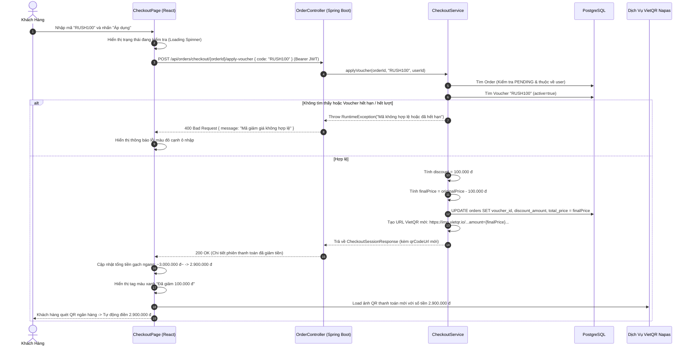
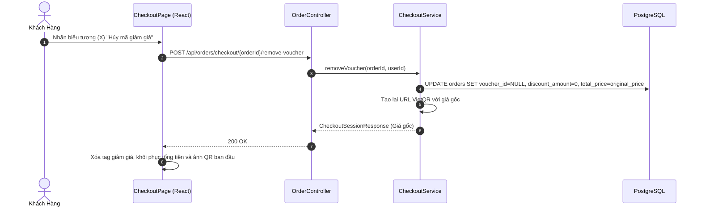

# TÀI LIỆU ĐẶC TẢ KỸ THUẬT: CƠ CHẾ ÁP DỤNG VOUCHER GIẢM GIÁ & SINH LẠI QR THANH TOÁN (DISCOUNT VOUCHER & DYNAMIC QR ENGINE)

* **Tên dự án:** TicketRush System
* **Phân hệ:** Checkout, Promotion & Dynamic Payment Engine
* **Trạng thái:** Architecture & Technical Specification
* **Phiên bản:** 1.0.0

---

## MỤC LỤC
1. [Tổng quan tính năng & Bối cảnh bài toán](#1-tổng-quan-tính-năng--bối-cảnh-bài-toán)
2. [Quy trình nghiệp vụ & Thuật toán tính giá](#2-quy-trình-nghiệp-vụ--thuật-toán-tính-giá)
3. [Mô hình Dữ liệu (Data Model Changes)](#3-mô-hình-dữ-liệu-data-model-changes)
4. [Danh sách file cần tạo mới & chỉnh sửa](#4-danh-sách-file-cần-tạo-mới--chỉnh-sửa)
5. [Sơ đồ tuần tự (Sequence Diagrams)](#5-sơ-đồ-tuần-tự-sequence-diagrams)
6. [Thiết kế API Chi tiết (API Contracts)](#6-thiết-kế-api-chi-tiết-api-contracts)
7. [Kế hoạch Kiểm thử (Test Cases Matrix)](#7-kế-hoạch-kiểm-thử-test-cases-matrix)
8. [Tiêu chuẩn hoàn thành (Definition of Done - DoD)](#8-tiêu-chuẩn-hoàn-thành-definition-of-done---dod)

---

## 1. TỔNG QUAN TÍNH NĂNG & BỐI CẢNH BÀI TOÁN

### 1.1. Thực trạng hiện tại của TicketRush
* Tại trang thanh toán (`CheckoutPage.jsx`), hệ thống chỉ lấy tổng tiền từ các ghế đã lock (`totalPrice = sum(seat.price)`) và hiển thị ảnh QR tĩnh chuyển khoản MB Bank.
* Chưa có cơ chế áp dụng mã khuyến mãi (Promo Code / Voucher), chưa có bảng lưu trữ mã giảm giá và chưa thể tự động tính toán lại số tiền thực trả khi có ưu đãi.
* Ảnh QR thanh toán là ảnh tĩnh (`qr_for_all.png`), người dùng phải tự nhập tay số tiền vào ứng dụng ngân hàng, dễ dẫn đến sai sót (chuyển thiếu/thừa tiền) hoặc làm chậm quá trình thanh toán trong 10 phút giữ chỗ.

### 1.2. Mục tiêu của tính năng Voucher & Dynamic QR
1. **Quy trình gọn gàng, tức thì (Frictionless Flow):** Khách hàng nhập mã $\rightarrow$ Hệ thống kiểm tra điều kiện hợp lệ $\rightarrow$ Trừ tiền trực tiếp $\rightarrow$ Cập nhật lại giao diện và sinh lại mã VietQR chuẩn xác với đúng số tiền đã giảm.
2. **Đa dạng hình thức giảm giá:**
   * Giảm theo số tiền cố định (`FIXED_AMOUNT`: ví dụ giảm thẳng 50.000 đ hoặc 100.000 đ).
   * Giảm theo phần trăm (`PERCENTAGE`: ví dụ giảm 10%, có chặn mức giảm tối đa `maxDiscount`).
3. **Kiểm soát chặt chẽ điều kiện:** Đơn hàng tối thiểu (`minOrderPrice`), thời hạn hiệu lực (`startDate`, `endDate`), tổng số lượt sử dụng (`totalQuantity`) và giới hạn theo sự kiện cụ thể.
4. **Đồng bộ VietQR chuẩn ngân hàng:** Sinh URL VietQR động (`https://img.vietqr.io/...`) chứa sẵn mã ngân hàng, số tài khoản, số tiền sau giảm và cú pháp chuyển khoản (`ORDER <Mã_Đơn>`). Khách hàng quét mã trên app ngân hàng sẽ thấy số tiền tự điền chính xác 100%.

---

## 2. QUY TRÌNH NGHIỆP VỤ & THUẬT TOÁN TÍNH GIÁ

### 2.1. Vòng đời áp dụng Voucher (Voucher Lifecycle trong phiên 10 phút)

```
[ Đơn Hàng PENDING ] ──► [ Nhập Mã Voucher ] ──► [ Kiểm Tra Hợp Lệ ]
                                                         │
                        ┌────────────────────────────────┴────────────────────────────────┐
                        ▼ Hợp lệ                                                          ▼ Không hợp lệ
            [ Tính Số Tiền Giảm ]                                               [ Báo lỗi chi tiết ]
                        │                                                       (Hết hạn, sai mã,
                        ▼                                                       chưa đủ min spend...)
            [ Cập nhật totalPrice = originalPrice - discount ]
                        │
                        ▼
            [ Sinh lại mã VietQR theo số tiền mới ]
                        │
         ┌──────────────┴──────────────┐
         ▼ Người dùng bấm HỦY MÃ        ▼ Đơn COMPLETED
 [ Hoàn lại giá gốc ban đầu ]     [ Tăng used_quantity của Voucher ]
```

### 2.2. Thuật toán tính toán số tiền giảm
Cho đơn hàng có giá gốc $P_{original}$:
* **Nếu loại giảm giá là Cố định (`FIXED_AMOUNT`):**
  $$D = \min(V_{discount}, P_{original})$$
* **Nếu loại giảm giá là Phần trăm (`PERCENTAGE`):**
  $$D_{raw} = P_{original} \times \frac{V_{discount}}{100}$$
  $$D = \begin{cases} \min(D_{raw}, M_{max}) & \text{nếu có quy định } M_{max} \\ D_{raw} & \text{ngược lại} \end{cases}$$
* **Số tiền thanh toán cuối cùng:**
  $$P_{final} = \max(0, P_{original} - D)$$

### 2.3. Quy chuẩn tạo Dynamic VietQR URL
* **Cấu trúc URL VietQR chuẩn Napas 247:**
  ```
  https://img.vietqr.io/image/{BANK_ID}-{ACCOUNT_NO}-compact2.png?amount={AMOUNT}&addInfo={CONTENT}&accountName={ACCOUNT_NAME}
  ```
* **Tham số cấu hình:**
  * `BANK_ID`: `MB` (Ngân hàng Quân Đội)
  * `ACCOUNT_NO`: `190088886666`
  * `AMOUNT`: $P_{final}$ (Đã làm tròn số nguyên)
  * `CONTENT`: `ORDER {orderId_8_chars}` (Ví dụ: `ORDER A1B2C3D4`)
  * `ACCOUNT_NAME`: `CONG TY TICKETRUSH`

---

## 3. MÔ HÌNH DỮ LIỆU (DATA MODEL CHANGES)

### 3.1. Bảng mới: `vouchers` (Quản lý mã giảm giá)

| Tên Cột | Kiểu Dữ Liệu | Ràng Buộc | Mô Tả |
| :--- | :--- | :--- | :--- |
| `id` | `UUID` | `PRIMARY KEY` | Khóa chính tự sinh |
| `code` | `VARCHAR(50)` | `NOT NULL, UNIQUE` | Mã voucher viết hoa (ví dụ: `RUSH100`, `SALE10`) |
| `description` | `VARCHAR(255)` | `NULL` | Mô tả ngắn (ví dụ: *"Giảm 100k cho đơn từ 500k"*) |
| `discount_type` | `VARCHAR(20)` | `NOT NULL` | `FIXED_AMOUNT` hoặc `PERCENTAGE` |
| `discount_value` | `DOUBLE PRECISION`| `NOT NULL` | Giá trị giảm (100000.0 hoặc 10.0) |
| `max_discount` | `DOUBLE PRECISION`| `NULL` | Mức giảm tối đa áp dụng cho loại % (ví dụ 200000.0) |
| `min_order_price` | `DOUBLE PRECISION`| `NULL` | Giá trị đơn hàng tối thiểu để được áp dụng |
| `total_quantity` | `INTEGER` | `NOT NULL DEFAULT 1000` | Tổng số lượt dùng tối đa |
| `used_quantity` | `INTEGER` | `NOT NULL DEFAULT 0` | Số lượt đã sử dụng thành công |
| `start_date` | `TIMESTAMP` | `NULL` | Thời điểm bắt đầu có hiệu lực |
| `end_date` | `TIMESTAMP` | `NULL` | Thời điểm hết hạn |
| `active` | `BOOLEAN` | `NOT NULL DEFAULT TRUE` | Trạng thái kích hoạt (Bật/Tắt) |
| `event_id` | `UUID` | `NULL, FK -> events(id)` | Nếu null: Áp dụng toàn sàn; Nếu có: Chỉ áp dụng cho event này |

### 3.2. Thay đổi bảng `orders` hiện có
Bổ sung các trường lưu vết giảm giá để phục vụ xuất hóa đơn và đối soát:

| Tên Cột | Kiểu Dữ Liệu | Ràng Buộc | Mô Tả |
| :--- | :--- | :--- | :--- |
| `original_price` | `DOUBLE PRECISION` | `NULL` | Giá gốc của giỏ vé trước khi áp mã |
| `discount_amount` | `DOUBLE PRECISION` | `NOT NULL DEFAULT 0.0` | Số tiền được giảm giá |
| `voucher_id` | `UUID` | `NULL, FK -> vouchers(id)`| Khóa ngoại tham chiếu đến voucher đã áp dụng |

---

## 4. DANH SÁCH FILE CẦN TẠO MỚI & CHỈNH SỬA

```
backend/
├── src/main/java/com/ticketrush/
│   ├── model/
│   │   ├── entity/
│   │   │   ├── Voucher.java                    [TẠO MỚI: Entity quản lý mã giảm giá]
│   │   │   └── Order.java                      [CHỈNH SỬA: Thêm originalPrice, discountAmount, voucher]
│   │   └── dto/
│   │       └── CheckoutSessionResponse.java    [CHỈNH SỬA: Thêm originalPrice, discountAmount, voucherCode, qrCodeUrl]
│   ├── repository/
│   │   └── VoucherRepository.java              [TẠO MỚI: Truy vấn voucher theo code và trạng thái active]
│   ├── service/
│   │   └── CheckoutService.java                [CHỈNH SỬA: Thêm applyVoucher(), removeVoucher(), cập nhật confirmSession()]
│   ├── controller/
│   │   └── OrderController.java                [CHỈNH SỬA: Thêm endpoint POST apply-voucher & remove-voucher]
│   └── config/
│       └── VoucherDataInitializer.java         [TẠO MỚI: Seeder tạo sẵn mã mẫu RUSH100, SALE10, VIP50 khi khởi động]

frontend/
├── src/
│   ├── api/
│   │   └── eventApi.js                         [CHỈNH SỬA: Thêm hàm applyVoucher(orderId, code) và removeVoucher(orderId)]
│   └── pages/
│       └── CheckoutPage.jsx                    [CHỈNH SỬA: Thêm khối nhập mã, hiển thị mức giảm và render QR động mới]
```

---

## 5. SƠ ĐỒ TUẦN TỰ (SEQUENCE DIAGRAMS)

### 5.1. Luồng Áp Dụng Mã Giảm Giá & Sinh Lại QR Thanh Toán



---

### 5.2. Luồng Hủy Áp Dụng Voucher (Khôi Phục Giá Gốc)



---

## 6. THIẾT KẾ API CHI TIẾT (API CONTRACTS)

### 6.1. API Áp Dụng Voucher
* **Endpoint:** `POST /api/orders/checkout/{orderId}/apply-voucher`
* **Quyền hạn:** `USER` (Phải là chủ sở hữu của đơn hàng)
* **Headers:** `Authorization: Bearer <user_jwt_token>`
* **Request Body:**
  ```json
  {
    "code": "RUSH100"
  }
  ```
* **Response Thành công (200 OK):**
  ```json
  {
    "orderId": "3fa85f64-5717-4562-b3fc-2c963f66afa6",
    "showtimeId": "c8b417e2-45e1-4c6f-a45b-7b02db9e18b1",
    "status": "PENDING",
    "originalPrice": 3000000.0,
    "discountAmount": 100000.0,
    "totalPrice": 2900000.0,
    "voucherCode": "RUSH100",
    "voucherDescription": "Giảm ngay 100.000 đ cho đơn hàng từ 500.000 đ",
    "qrCodeUrl": "https://img.vietqr.io/image/MB-190088886666-compact2.png?amount=2900000&addInfo=ORDER%203FA85F64&accountName=CONG%20TY%20TICKETRUSH",
    "selectedSeats": [ ... ]
  }
  ```
* **Mã lỗi thường gặp:**
  * `400 Bad Request`: Mã voucher không tồn tại, hết hạn, hoặc đơn hàng chưa đạt giá trị tối thiểu.
  * `403 Forbidden`: Đơn hàng không thuộc về tài khoản hiện tại.

---

### 6.2. API Hủy Áp Dụng Voucher
* **Endpoint:** `POST /api/orders/checkout/{orderId}/remove-voucher`
* **Quyền hạn:** `USER`
* **Headers:** `Authorization: Bearer <user_jwt_token>`
* **Response Thành công (200 OK):**
  Trả về `CheckoutSessionResponse` với `discountAmount = 0.0`, `totalPrice = originalPrice`, `voucherCode = null` và ảnh QR cập nhật lại số tiền gốc.

---

## 7. KẾ HOẠCH KIỂM THỬ (TEST CASES MATRIX)

| Test ID | Tên Kịch Bản | Dữ Liệu Đầu Vào | Kết Quả Mong Đợi |
| :--- | :--- | :--- | :--- |
| **TC-01** | **Áp mã cố định thành công** | Đơn 1.000.000 đ, nhập mã `RUSH100` (-100k) | Giảm đúng 100.000 đ, tổng tiền còn 900.000 đ, QR url mang `amount=900000` |
| **TC-02** | **Áp mã phần trăm có giới hạn tối đa** | Đơn 3.000.000 đ, nhập `SALE10` (10% tối đa 200k) | 10% là 300k > maxDiscount 200k $\rightarrow$ Chỉ giảm 200.000 đ, tổng tiền 2.800.000 đ |
| **TC-03** | **Chưa đạt giá trị đơn hàng tối thiểu** | Đơn 300.000 đ, nhập mã `RUSH100` (min spend 500k) | Báo lỗi 400: *"Đơn hàng tối thiểu phải từ 500.000 đ"* |
| **TC-04** | **Mã voucher không tồn tại** | Nhập mã `KHONGCOMA` | Báo lỗi 400: *"Mã giảm giá không tồn tại hoặc đã hết hiệu lực"* |
| **TC-05** | **Mã voucher đã hết lượt sử dụng** | Voucher có `usedQuantity >= totalQuantity` | Báo lỗi 400: *"Mã giảm giá đã hết lượt sử dụng"* |
| **TC-06** | **Hủy áp dụng mã giảm giá** | Bấm hủy mã voucher đang áp dụng | Tổng tiền trở về giá gốc, mã QR cập nhật lại giá gốc |
| **TC-07** | **Xác nhận thanh toán hoàn tất** | Bấm "Xác nhận đã chuyển" | Đơn hàng thành `COMPLETED`, số lượt dùng của voucher tăng thêm 1 |

---

## 8. TIÊU CHUẨN HOÀN THÀNH (DEFINITION OF DONE - DOD)

1. **Backend:**
   * [ ] Tạo thành công Entity `Voucher.java` và bổ sung trường giảm giá vào `Order.java`.
   * [ ] Tạo `VoucherRepository.java` và class seeder `VoucherDataInitializer.java` tự sinh sẵn 3 mã test (`RUSH100`, `SALE10`, `VIP50`).
   * [ ] Hoàn thiện 2 method `applyVoucher` và `removeVoucher` trong `CheckoutService.java` đảm bảo tính toán giá chính xác.
   * [ ] Tích hợp logic sinh URL VietQR tự động theo số tiền thực tế trong `mapSession`.
   * [ ] Đơn hàng hoàn tất (`COMPLETED`) ghi nhận tăng `used_quantity` của voucher.

2. **Frontend:**
   * [ ] Giao diện `CheckoutPage.jsx` có ô nhập mã khuyến mãi tinh tế, có nút "Áp dụng" (hỗ trợ phím Enter).
   * [ ] Hiển thị danh sách các thẻ gợi ý mã nhanh (Pills tag: `RUSH100`, `SALE10`, `VIP50`) để người dùng click 1 chạm.
   * [ ] Hiển thị thông báo kết quả rõ ràng (Xanh lá khi thành công, Đỏ khi có lỗi).
   * [ ] Bảng tổng tiền hiển thị rõ: **Tạm tính (Giá gốc)**, **Mã giảm giá (-X đ)**, và **Tổng thanh toán**.
   * [ ] Ảnh QR chuyển khoản hiển thị sắc nét và tự động đổi theo số tiền mới ngay khi áp mã.

